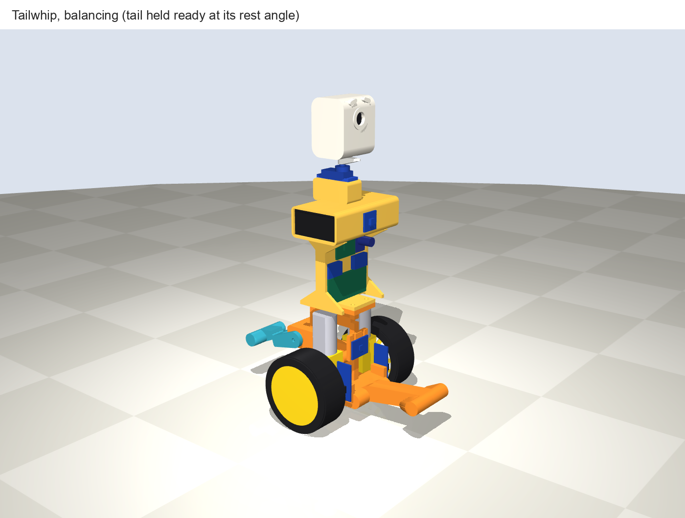

# Tailwhip: the robot that sits on its tail

Build a two-wheeled balancing robot that rests on its tail like a kangaroo, rears up onto its wheels, looks around,
and lands on its tail when you shove it. Two $2 TT gearmotors, two hobby servos, an ESP32, an MPU6050, two 18650
cells and seven 3D-printed parts. Its brain is a small neural network you train with reinforcement learning in
MuJoCo on your laptop, then run on the robot.

Everything is in this repository: the parametric CAD and print files, the MuJoCo simulation, the training code and
a trained policy, the Arduino firmware, the laptop tools and a step-by-step build plan. The project website, built
from this repo, walks through it page by page: **https://tailwhip.buildrobotz.com**

> **AI-generated, not yet built.** This design, its code and its documentation were generated with AI, and nobody
> has built or tested a physical Tailwhip yet. The CAD passes a numerical design check, the simulator is built from
> the CAD with every sloppy part made sloppy on purpose, and every performance number here comes from simulation
> across randomised robots. Treat it as a well-worked starting point: measure what the docs tell you to, check each
> step, expect to fix things, and build at your own risk, especially around the 18650 cells.



## Start with stage 1

Before the full robot, build **stage 1** (`stage1/`, and the Stage 1 guide on the website): a bare-minimum balancer
with one dual-shaft TT motor, a wheel on each end, two 18650s, an ESP32, an MPU-6050 and an MX1508, kept upright by
a PID loop. Its one job is to prove a TT motor is fast enough to balance a body. It is designed and simulated, not
built; its firmware compiles but has not run on hardware. Stage 2 (two motors, the body held at a lean by a fixed
weight) is planned but not designed yet; stage 3 is the full Tailwhip. Follow the step-by-step guide, `stage1/GUIDE.md` (the Stage 1 page on the website); the design note is
`stage1/README.md`.

| Path | What it is |
|---|---|
| `stage1/` | Stage 1, build it first: the one-motor PID balancer (step-by-step guide, design note, CAD and print files, electronics, MuJoCo simulation, firmware) |
| `cad/tailwhip.py` | Parametric geometry: every dimension tagged [D]atasheet / [E]stimate / [C]hosen, every part, the joints |
| `cad/analysis.py` → `cad/out/analysis.md` | Mass, centre of mass, interference, tail sweep, falls, tail torque, leaf spring, bed fit: PASS/FAIL |
| `cad/export.py` → `cad/out/` | Print STLs in print orientation, assembled GLB/STL, renders |
| `sim/tailwhip_model.py` → `sim/tailwhip.xml` | The MuJoCo model, generated from the CAD |
| `sim/tailwhip_env.py` | Gymnasium environment: DC motor model, backlash, servo limits, coarse encoders, delay, randomisation |
| `sim/train.py`, `sim/evaluate.py`, `sim/demo.py`, `sim/test_falls.py` | Train, score over randomised robots, film the act, drop tests |
| `sim/export_policy.py` → `firmware/tailwhip_robot/policy.h` | The trained network as a C header for the ESP32 |
| `sim/policies/` | The trained policy, ready to run |
| `firmware/` | Arduino sketches: the robot, the USB radio bridge, an I2C scanner, a servo centring tool |
| `host/` | Laptop side: serial link, keyboard driving, bench tests and measurements, running the policy |
| `docs/` | Build plan, parts, mechanical, electronics, software, simulation, learning path, limits |
| `visual/` | The Blender design animation (kinematic, from the CAD) |
| `site/` | The website: `python site/build_site.py` writes `site/dist/` |
| `SPEC.md` | The original design brief |

## Quick start (no hardware needed)

```bash
python -m venv .venv && .venv/bin/pip install mujoco gymnasium stable-baselines3 numpy manifold3d trimesh
.venv/bin/python sim/test_falls.py        # drop tests: where it lands when it falls
.venv/bin/python sim/demo.py              # the trained policy through the whole act -> sim/out/demo.mp4
.venv/bin/python sim/evaluate.py          # score it over 50 randomised robots per test
.venv/bin/python sim/train.py             # train your own (about 45 min on a 10-core laptop)
```

## Building one

Build stage 1 first (`stage1/GUIDE.md`, or the Stage 1 guide on the website) and get it to pass: 60 s standing,
a recovery from 8 degrees, light pokes. Then follow the build plan (`docs/build.md`, or the Build plan page on the
website). In short: order the parts,
measure your TT motor and wheel, print, build the power system on the bench with a meter, assemble, run every bench
test, drive it on its tail, tune the PID balancer, then run the policy from the laptop and finally on the robot.

## Licence

Code is MIT; documentation, drawings, CAD and print files are CC BY-SA 4.0. See `LICENSE`.
Tailwhip is a [BuildRobotz](https://buildrobotz.com) project, and a sister of [Ouro](https://ouro.buildrobotz.com).
