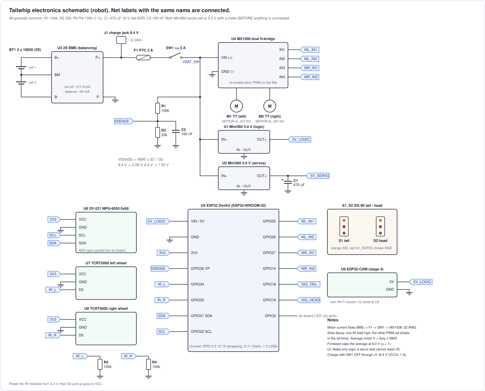
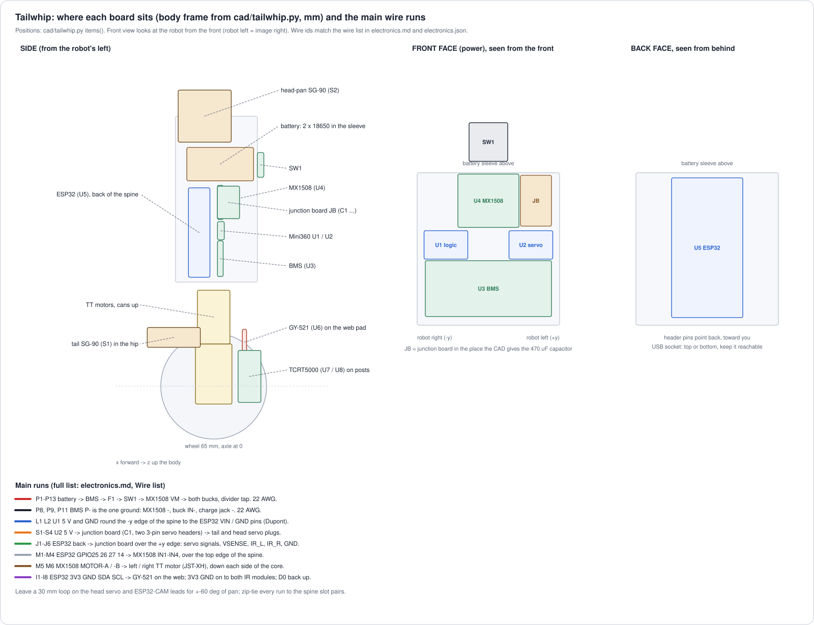

# Tailwhip electronics

> **AI-generated and unbuilt.** Nothing on this page has been wired, powered or measured. Every number is tagged
> [D] datasheet or seller listing, [E] estimate, or [C] chosen by this design. Treat the meter readings in the
> bring-up as gates: do not move to the next step until you get the reading the table gives.

This page takes you from a bag of parts to a robot that answers the laptop. You get the whole circuit in one picture, where every board sits on the spine, a point-to-point wire list, the power budget, and a bring-up sequence with the meter reading you should see at each step. The reference (pin map, decay mode, wheel sensing, IMU, numbers to measure) sits at the end.

---

## What you are building

Drawings: [`schematic.svg`](schematic.svg) (the circuit) and [`wiring.svg`](wiring.svg) (where each board sits, from the CAD, and the main wire runs). The netlist, pin map, wire list and power budget in machine-readable form: [`electronics.json`](electronics.json). All three come from one model, `docs/tools/gen_electronics.py`, which reads the board positions from `cad/tailwhip.py` and checks that every net is drawn at both ends, every off-board net has a wire, and no labels overlap.





### How it works

Two 18650 cells in a series holder sit in the battery sleeve on top of the spine (7.4 V nominal, 8.4 V full). The cells have no protection of their own, so the first thing their current meets is a **2S BMS** with balancing (U3). It cuts off at about 2.5 V per cell, on a short, and on over-current, and it trickles the higher cell down while charging. A charge jack (J1) hangs off the BMS output, so the pack charges in place with the robot switched off.

From the BMS the current goes through a **3 A resettable fuse** (F1) and the **power switch** (SW1) to the switched battery rail, VBAT_SW. Three things hang on it:

- the **MX1508** motor driver (U4), straight from the battery, for the two TT motors;
- **Mini360 buck U1**, set to 5.0 V, for the ESP32 (and later the ESP32-CAM): the logic rail;
- **Mini360 buck U2**, set to 5.0 V, for the two servos, with 470 µF across its output: the servo rail.

A 100k/33k divider scales the battery to under 2.1 V for the ESP32's ADC on GPIO36.

The ESP32 on the back of the spine drives the MX1508's four inputs with 20 kHz PWM, the two servo signals at 50 Hz, and reads the MPU-6050 on the motor web over I2C at 400 kHz. Two TCRT5000 IR modules on posts look at the 16-window rings glued inside the wheels; their digital outputs go to GPIO34 and GPIO35 (32 edges per wheel turn).

A small **junction board** (JB, about 13 x 20 mm of perfboard, 5 x 8 holes) sits on the spine front beside the MX1508. It carries the servo rail (C1 and two 3-pin servo headers), the battery divider (R1, R2, C2) and the two IR pull-downs (R3, R4), so every small part lives in one place and the ESP32 connects to it with Dupont leads.

A second ESP32, the **bridge**, sits on the laptop's USB. It copies state packets from ESP-NOW to serial and command packets from serial to ESP-NOW. The [Software](software.md) page describes the programs and packets.

### Why the circuit looks like this

| Choice | Reason |
|---|---|
| **Slow decay** on the MX1508 (one input held high, the other PWM-ed) | See [Decay mode](#decay-mode-slow-and-why). In short: average motor voltage = duty x battery voltage at every speed, so wheel speed is close to linear in the command down to low speeds, and u = 0 brakes the motor, which is exactly what the simulator assumes (motor voltage = u x 6.0 V). |
| **Average motor voltage capped at 6.0 V** in firmware | TT motors are rated 3-6 V [D]. The pack is 8.4 V full. The firmware sets duty = u x 6.0 V / VBAT, so u = 1 is 6.0 V whatever the charge state, and the policy's actions mean the same thing on a full and an empty pack. |
| **Two Mini360 bucks** | A Mini360 is good for about 1 A continuous in practice [E] (listings say 1.8 A [D], 3 A surge). Two SG-90s can pull 1.3 A together at stall [D]. If the ESP32 shared that rail, a tail stall would brown out the radio exactly when the robot is in trouble. |
| **470 µF on the servo rail** | Servo start-up spikes are short and large. The capacitor carries them so the Mini360 sees the average. If the servo rail is dead at switch-on (some bucks latch into a large capacitor), drop to 220 µF. |
| **3 A polyfuse after the BMS** | The BMS protects the cells; the fuse protects the wiring between the BMS and the boards. Normal running is well under 1 A [E]; both motors and both servos stalled at once is about 4 A for a second [E], under the 6 A trip. |
| **Power switch rated 3 A or more** | It carries all the motor current. The tiny SS12D00 slide switches are rated 0.3-0.5 A [D] and will weld or burn. The CAD puts the Pololu 2810 MOSFET slide switch board on the front of the battery sleeve, where it is easy to reach. |
| **IR modules on 3.3 V** | The module's output pull-up goes to its own VCC. At 5 V it would put 5 V on GPIO34/35, which are 3.3 V pins. |
| **100k pull-downs on GPIO34/35** | These pins have no internal pull resistors. With a sensor unplugged the input would float and count noise as wheel edges; the pull-down holds it at 0, and the firmware then sees "no edges while driving" and falls back to IMU-only. |
| **GPIO36 for the battery** | ADC1 channel 0 works while the radio is on (ADC2 does not). |
| **Charge jack on the BMS output, before the fuse and switch** | Charge with the robot switched off; the charge current does not pass the switch. |

---

## Parts on this page

Per robot. Sources and prices are on the [Parts](parts.md) page.

| Ref | Part | Qty | Notes |
|---|---|---|---|
| U5, bridge | ESP32 DevKit, **ESP32-WROOM-32** (classic) | 2 | Not S2, S3 or C3. 30- or 38-pin. |
| U3 | 2S Li-ion BMS **with balancing**, 10 A (e.g. HX-2S-JH20) | 1 | About 50 x 22 x 3.5 mm [D]; the CAD gives it the bottom of the spine front. Needs the cell middle (BM) wire. |
| F1 | PTC fuse 3 A hold / 6 A trip, radial, 16 V or more (RUEF300, MF-R300) | 1 | |
| SW1 | Power switch, 3 A DC or more (Pololu 2810 MOSFET slide switch, or a KCD11 mini rocker) | 1 | Not an SS12D00. |
| J1 | DC 5.5 x 2.1 mm female pigtail | 1 | Charge jack. |
| U4 | MX1508 dual H-bridge module | 1 | 2-9.6 V [D]. |
| U1, U2 | Mini360 adjustable buck | 2 | **Set to 5.0 V with a meter before connecting anything.** |
| C1 | 470 µF 16 V low-ESR electrolytic | 1 | On the junction board, across the servo rail. |
| R1, R3, R4 | 100 kΩ 1 % | 3 | Divider top, IR pull-downs. |
| R2 | 33 kΩ 1 % | 1 | Divider bottom. |
| C2 | 100 nF ceramic | 1 | Across R2. |
| JB | Perfboard, 5 x 8 holes (about 13 x 20 mm), plus 2 x 3-pin male header | 1 | The junction board. |
| U6 | GY-521 MPU-6050 | 1 | |
| U7, U8 | TCRT5000 IR module with LM393, digital D0 | 2 | |
| S1, S2 | SG-90 servo (MG90S as the fallback for the tail) | 2 | |
| M1, M2 | TT gearmotor 1:48 | 2 | JST-XH 2-pin plug on each. |
| | 22 AWG silicone wire red/black, 26 AWG assorted, Dupont F-F 10 cm, heat-shrink | | |

---

## Battery safety and charging

Read this before you put cells in the holder.

- **The cells are unprotected.** Nothing inside them stops an over-discharge, an over-charge or a short. The BMS does that job, so the BMS goes on before anything else and nothing ever connects to the cells except through it.
- **Use genuine high-drain cells, a matched pair.** Same model, same age, voltages within 0.05 V of each other before they go in. Never "UltraFire", "GTF" or "9900 mAh" cells; buy from a battery specialist (see [Parts](parts.md)). A good cell (Molicel P28A, Samsung 25R or 30Q, Sony VTC6) has a low internal resistance, so the pack sags little when the motors pull.
- **Check each cell before it goes in:** 3.0 to 4.2 V on the meter. Retire any cell under 2.5 V, dented, with a torn wrap, or warm at rest.
- **Wire the BMS in this order:** B- first, then BM (the strap joining the two cells), then B+. Undo it in the reverse order. Many 2S boards show 0 V on P+/P- until a charger has been connected once; that is normal.
- **Charge** with the robot switched off, through J1, with an **8.4 V CC/CV charger** at about 1 A, on a non-flammable surface, attended. The balancing BMS evens the cells at about 40 mA [D], so check the two cell voltages once a month: if they differ by more than 0.05 V at full charge, charge each one in a single-cell smart charger.
- **Switch off at the end of every run.** After the firmware's low-battery cut-off the ESP32 sleeps, but the bucks, the IR LEDs and the regulators still draw roughly 40-60 mA [E]. The BMS stops it at about 2.5 V per cell, which the cells survive, but it is a deep discharge you do not want.
- **There is no reverse-polarity protection** apart from the Pololu MOSFET switch (it has some). Check polarity with the meter at bring-up step 2, before the boards are connected.

---

## Wiring

### Where everything sits

The positions come from `cad/tailwhip.py` (body frame: x forward, y left, z up the body, origin on the axle). See [`wiring.svg`](wiring.svg).

| Board and where | Body-frame box (mm) |
|---|---|
| U5 ESP32, back face of the spine | x -15.5..-2.3, y -14.0..14.0, z 67.0..122.0 |
| U4 MX1508, spine front, top middle | x 2.3..5.9, y -12.0..12.0, z 102.5..123.5 |
| U1 logic buck, spine front, -y | x 2.3..6.5, y -25.3..-8.1, z 90.0..101.2 |
| U2 servo buck, spine front, +y | x 2.3..6.5, y 8.1..25.3, z 90.0..101.2 |
| U3 BMS (50 x 22 mm), spine front, across the bottom | x 2.3..5.8, y -24.8..24.8, z 67.4..89.4 |
| JB junction board with C1, spine front, +y top | x 2.3..15.9, y 12.6..24.8, z 103.0..123.0 |
| SW1 Pololu MOSFET slide switch, front of the battery sleeve | x 26.8..30.8, y -7.6..7.6, z 128.5..143.7 |
| U6 GY-521, pad on the motor web | x 17.6..20.2, y -10.5..10.5, z 19.0..35.0 |
| U7 IR module, left post | x 15.0..29.0, y 24.3..25.9, z -10.0..22.0 |
| U8 IR module, right post | x 15.0..29.0, y -25.9..-24.3, z -10.0..22.0 |
| BT1 cells, battery sleeve | x -16.5..24.5, y -38.8..38.8, z 126.3..146.8 |
| S1 tail servo, hip block | x -40.8..-8.2, y -20.0..12.0, z 23.9..36.1 |
| S2 pan servo, sleeve roof | x -21.8..10.8, y -6.1..6.1, z 150.1..182.1 |

The motors stand vertically either side of the core, the IMU is zip-tied to the pad on the front of the motor web (chip facing forward, its x axis up the body), the IR modules screw to their posts beside each wheel, the tail servo sits in the hip block and the pan servo on the sleeve roof.

### Build the junction board

A scrap of perfboard 5 holes wide and 8 long. Lay it out like this (top = up the body), solder, then zip-tie it to the spine front at the +y side, beside the MX1508:

1. Two 3-pin male headers side by side at the top: **T** (tail) and **H** (head). Pin order on each, left to right: signal, +5 V, GND (the servo plug's orange, red, brown).
2. Join both +5 V pins to a **5V_SERVO** bus row and both GND pins to a **GND** bus row on the back.
3. **C1** 470 µF between the two bus rows, stripe (negative) to GND. Bring in **S1** (red, 22 AWG) from U2 OUT+ and **S2** (black) from U2 OUT- on the same rows.
4. **R1** 100k from a pad for the battery tap (P13) to a **VSENSE** pad; **R2** 33k from VSENSE to GND; **C2** 100 nF beside R2.
5. **R3** 100k from an **IR_L** pad to GND, **R4** 100k from an **IR_R** pad to GND.
6. Short tails of 26 AWG to Dupont female housings for the ESP32 side (J1-J6 below), and solder pads for I7, I8 (IR outputs).

Check with the meter before plugging anything in: 5V_SERVO to GND reads the capacitor charging (rising), not 0 Ω; VSENSE to GND reads about 25 kΩ (33k in parallel with 100k).

### Wire list

Every wire, point to point. Lengths are estimates from the CAD positions plus slack; cut long and trim.

| Id | From | To | Net | Colour | AWG | mm | Route / note |
|---|---|---|---|---|---|---|---|
| P1 | BT1 + (holder red lead) | U3 B+ | CELL+ | red | 22 | 60 | sleeve floor window -> top of spine front. holder lead, shortened |
| P2 | BT1 - (holder black lead) | U3 B- | CELL- | black | 22 | 60 | same. holder lead, shortened |
| P3 | BT1 middle (strap joining the cells) | U3 BM | CELL_MID | yellow | 26 | 70 | same. solder to the holder's series strap; balancing and per-cell protection need it |
| P4 | U3 P+ | F1 lead 1 (in heat-shrink) | PACK+ | red | 22 | 30 | spine front, -y side |
| P5 | F1 lead 2 | SW1 IN | VBAT_F | red | 22 | 40 | spine front, up to the switch |
| P6 | SW1 OUT | U4 VM (+) | VBAT_SW | red | 22 | 30 | spine front. then daisy-chain on to U1 IN+ (P7) |
| P7 | U4 VM (+) | U1 IN+ and U2 IN+ | VBAT_SW | red | 22 | 60 | spine front, down to the bucks. one wire to each buck, both on the VM screw |
| P8 | U3 P- | U4 GND (-) | GND | black | 22 | 50 | spine front. main ground; then U1 IN-, U2 IN- (P9) |
| P9 | U4 GND (-) | U1 IN- and U2 IN- | GND | black | 22 | 60 | spine front |
| P10 | J1 + (charge jack, red) | U3 P+ | PACK+ | red | 22 | 80 | out of the -y side of the spine. jack hangs on a 6 cm tail |
| P11 | J1 - (charge jack, black) | U3 P- | GND | black | 22 | 80 | same |
| P12 | SW1 GND (Pololu switch only) | U4 GND (-) | GND | black | 26 | 30 | spine front. not needed with a mechanical rocker |
| P13 | VBAT_SW (U4 VM) | JB R1 top | VBAT_SW | red | 26 | 40 | spine front. thin wire: divider only |
| L1 | U1 OUT+ | U5 VIN / 5V | 5V_LOGIC | red | 26 | 90 | round the -y edge of the spine to the back. Dupont female on the ESP32 header pin |
| L2 | U1 OUT- | U5 GND | GND | black | 26 | 90 | with L1. Dupont female on the ESP32 header pin |
| S1 | U2 OUT+ | JB 5V_SERVO (C1 +) | 5V_SERVO | red | 22 | 30 | spine front, +y side |
| S2 | U2 OUT- | JB GND (C1 -) | GND | black | 22 | 30 | with S1 |
| S3 | JB servo header T | S1 tail servo plug | SIG_TAIL / 5V_SERVO / GND | servo lead | 26 | 110 | down the spine back to the hip block. SG-90 lead is ~250 mm: coil the spare |
| S4 | JB servo header H | S2 head servo plug | SIG_HEAD / 5V_SERVO / GND | servo lead | 26 | 80 | up the spine, past the sleeve. leave a loop for +-60 deg of pan |
| J1 | U5 GPIO18 | JB header T signal pin | SIG_TAIL | orange | 26 | 70 | +y edge of the spine. Dupont female on the ESP32 header pin |
| J2 | U5 GPIO19 | JB header H signal pin | SIG_HEAD | yellow | 26 | 70 | +y edge of the spine. Dupont female on the ESP32 header pin |
| J3 | U5 GND (second pin) | JB GND | GND | black | 26 | 70 | +y edge of the spine. Dupont female on the ESP32 header pin; the logic and junction grounds must meet |
| J4 | U5 GPIO36 (VP) | JB R1/R2 junction | VSENSE | violet | 26 | 70 | +y edge. Dupont female on the ESP32 header pin |
| J5 | U5 GPIO34 | JB R3 / IR_L in | IR_L | green | 26 | 70 | +y edge. Dupont female on the ESP32 header pin |
| J6 | U5 GPIO35 | JB R4 / IR_R in | IR_R | blue | 26 | 70 | +y edge. Dupont female on the ESP32 header pin |
| M1 | U5 GPIO25 | U4 IN1 | ML_IN1 | white | 26 | 60 | over the top of the spine. Dupont female on the ESP32 header pin; Dupont or solder at the MX1508 |
| M2 | U5 GPIO26 | U4 IN2 | ML_IN2 | grey | 26 | 60 | with M1. Dupont female on the ESP32 header pin |
| M3 | U5 GPIO27 | U4 IN3 | MR_IN1 | brown | 26 | 60 | with M1. Dupont female on the ESP32 header pin |
| M4 | U5 GPIO14 | U4 IN4 | MR_IN2 | violet | 26 | 60 | with M1. Dupont female on the ESP32 header pin |
| M5 | U4 MOTOR-A | M1 left motor tabs (JST-XH) | MOTA+ / MOTA- | red/black | 22 | 110 | +y side of the core, along the can. swap the pair if the wheel runs backwards, or "flip l" |
| M6 | U4 MOTOR-B | M2 right motor tabs (JST-XH) | MOTB+ / MOTB- | red/black | 22 | 110 | -y side of the core, along the can. or "flip r" in firmware |
| I1 | U5 3V3 | U6 VCC | 3V3 | red | 26 | 110 | down the front of the web. Dupont female on the ESP32 header pin; then on to the IR modules (I5, I6) |
| I2 | U5 GND (third pin) or JB GND | U6 GND | GND | black | 26 | 110 | with I1 |
| I3 | U5 GPIO21 | U6 SDA | SDA | blue | 26 | 110 | with I1, twisted with I4. Dupont female on the ESP32 header pin |
| I4 | U5 GPIO22 | U6 SCL | SCL | yellow | 26 | 110 | with I1. Dupont female on the ESP32 header pin |
| I5 | U6 VCC / GND (second wires) | U7 VCC / GND (left IR) | 3V3 / GND | red/black | 26 | 60 | along the web to the left post |
| I6 | U6 VCC / GND (second wires) | U8 VCC / GND (right IR) | 3V3 / GND | red/black | 26 | 60 | along the web to the right post |
| I7 | U7 D0 | JB IR_L | IR_L | green | 26 | 120 | up the web and the spine to the junction board |
| I8 | U8 D0 | JB IR_R | IR_R | blue | 26 | 120 | with I7 |
| C1 | U1 OUT+ / OUT- (second wires) | U9 ESP32-CAM 5V / GND | 5V_LOGIC / GND | red/black | 26 | 120 | up the back of the spine and sleeve to the head. stage 4 only; leave a loop for pan |

Motor polarity does not matter at the wiring stage: bring-up step 12 checks the direction and the firmware command `flip l` / `flip r` fixes it without re-soldering.

---

## Power budget

Assumptions: both rails at 5.0 V, buck efficiency 85 % [E], pack 7.4 V. Currents for the ESP32, MPU-6050, SG-90 and TT motor are from datasheets and listings [D]; what the robot draws while doing each thing is an estimate [E] until you measure it (bring-up step 15).

### Loads per rail

| Rail | Load | Typical (A) | Peak (A) | Source |
|---|---|---|---|---|
| logic 5 V | ESP32 radio on, ESP-NOW 100 Hz | 0.12 | 0.35 | [D] Espressif datasheet 5-4: RX 95-100 mA, TX 180-240 mA, plus CPU [E] |
| logic 5 V | GY-521 MPU-6050 | 0.004 | 0.004 | [D] 3.8-3.9 mA |
| logic 5 V | 2 x TCRT5000 module at 3.3 V | 0.03 | 0.03 | [E] IR LED ~10 mA + LM393 + power LED, each |
| logic 5 V | ESP32-CAM streaming (stage 4) | 0.25 | 0.31 | [D] 180 mA flash off, 310 mA flash on; [E] 230-250 mA measured by hobbyists |
| servo 5 V | Tail SG-90 holding the robot at rest | 0.25 | 0.65 | [E] hold; [D] 550-650 mA stall |
| servo 5 V | Head SG-90 panning | 0.1 | 0.65 | [E] moving; [D] stall |
| battery (motors) | Each TT motor, no load at 6 V | 0.16 | 1.5 | [D] Adafruit 3777: 160 mA no load, 1.5 A stall at 6 V |
| battery (motors) | Each TT motor, balancing | 0.4 | 1.5 | [E] average while balancing; peaks to stall |

### Battery current

| Case | Logic | Servos | Motors (at the battery) | **Pack current** |
|---|---|---|---|---|
| Idle, resting on the tail (tail servo holding) | 0.15 A | 0.25 A | 0 | **≈ 0.3 A** [E] |
| Driving on the tail, half speed | 0.15 A | 0.25 A | 2 x 0.3 A x duty 0.4 | **≈ 0.55 A** [E] |
| Balancing (PID or policy), tail held at rest | 0.15 A | 0.05 A | 2 x 0.4 A x duty 0.3 | **≈ 0.45 A** [E] |
| Stage 4: balancing with the ESP32-CAM streaming | 0.40 A | 0.15 A | as above | **≈ 0.65 A** [E] |
| Worst second: both motors and both servos stalled, camera on | 0.66 A | 1.3 A | 2 x 1.5 A x duty 0.81 | **≈ 4.0 A** [E] |

With slow decay, the battery supplies the motor current only during the drive part of each PWM cycle, so battery current ≈ duty x motor current. Two 2800 mAh cells (P28A) give about 2.4 Ah usable [E]: three to four hours of mixed bench and balancing work.

### What gives out first, in order

1. **The MX1508's weaker channel.** The MX1508 datasheet rates one channel at 1.5 A continuous and the other at 0.8 A continuous [D], and modules rarely say which is which. A TT motor stalls at about 1.5 A at 6 V [D]. Short stalls (a second while catching a fall) are fine; a robot pushing against a wall for 10 s is not. If one side starts cutting out when hot, swap in a DRV8833 or TB6612FNG board (both about 1.2-1.5 A continuous per channel, same two-input control).
2. **The servo buck U2.** About 1 A continuous [E]. Both servos stalled pull 1.3 A [D]. The tail servo holding the robot on its tail pulls about 0.25 A [E]. If the tail twitches or goes limp when the head moves, the rail is sagging: fit a larger buck (SPEC risk table), not a second Mini360 in parallel.
3. **The logic buck U1 at stage 4.** ESP32 plus ESP32-CAM is about 0.4 A typical, 0.66 A peak [D]. Fine for one Mini360. If the camera browns out anyway, give it its own (third) Mini360.
4. **The polyfuse.** 3 A hold, 6 A trip [D]: 4 A for a second will not trip it, but a hot fuse derates, so a long stall can. It resets once cool.
5. **The cells.** 4 A is under 2 C for a 2800 mAh cell; any genuine high-drain cell is rated 15 A or more [D].

### Voltage sag

Two good cells (about 15-20 mΩ each [E]), the BMS MOSFETs (about 10 mΩ [E]), the fuse (about 50-100 mΩ [D]) and the leads come to roughly 0.15 Ω. That is 0.1 V at 0.6 A and 0.6 V at 4 A. The firmware measures VBAT every 10 ms and scales the duty, so a sagging pack does not change what u = 1 means until VBAT falls below 6.0 V (flag `volt_clip`).

### Mini360 limits

No manufacturer datasheet exists for "Mini360"; it is an MP2307-type synchronous buck on a 17 x 11 mm board [D listings]. Input 4.75-23 V, 340 kHz, adjustable output by a tiny pot. Listings say 1.8 A continuous and 3 A surge; builders report it gets hot above about 1 A without airflow, so this design treats 1 A as the continuous limit [E]. **It ships set to a random voltage**, often 10 V or more, which kills an ESP32 or a servo at once. Set it with nothing on its output (bring-up step 4). The pot is touchy; turn it in small steps and give the meter a second to settle.

---

## Set up the firmware toolchain

You flash four sketches: `i2c_scan`, `servo_center` and `tailwhip_robot` to the robot's ESP32, and `tailwhip_bridge` to the bridge. No extra libraries are needed.

```
brew install arduino-cli
arduino-cli core update-index && arduino-cli core install esp32:esp32     # 3.3.12 tested to compile
arduino-cli compile -b esp32:esp32:esp32 firmware/tailwhip_robot
arduino-cli upload  -b esp32:esp32:esp32 -p /dev/cu.usbserial-XXXX firmware/tailwhip_robot
```

In the Arduino IDE the board is **"ESP32 Dev Module"** (FQBN `esp32:esp32:esp32`) with its defaults. If upload fails at 921600 on a CH340 board, set Upload Speed to 460800. If it hangs at "Connecting...", hold BOOT.

All four sketches compile with zero warnings on core 3.3.12 (`--warnings all`). The code also uses the core 2.0.x API where the two differ (LEDC, ESP-NOW receive callback). Sizes on 3.3.12:

| Sketch | Flash | RAM (globals) |
|---|---|---|
| `tailwhip_robot` | 992,427 B (75 %) | 49,380 B (15 %) |
| `tailwhip_bridge` | 886,912 B (67 %) | 45,832 B (13 %) |
| `servo_center` | 281,039 B (21 %) | 22,328 B (6 %) |
| `i2c_scan` | 294,372 B (22 %) | 23,500 B (7 %) |

`ROBOT_ID` and `WIFI_CHANNEL` live in `tailwhip_common.h`, which exists in both the robot and bridge sketch folders. The two copies must be identical; `host/test_protocol.py` checks.

---

## Bring-up, step by step

Each step has an expected reading. Do not move on until you get it. Motors unplugged (JST-XH) and servos unplugged until the step that needs them.

| # | Do | Expect |
|---|---|---|
| 0 | Bare robot DevKit on USB. Flash `i2c_scan`. Then flash the bridge DevKit with `tailwhip_bridge`. | `i2c_scan` prints `SDA=0` or `SDA=1` (no pull-ups yet is fine) and 0 devices. The bridge LED stays off (no robot yet); a fast blink means its radio failed. |
| 1 | Each cell on the meter, out of the holder | 3.0-4.2 V each, within 0.05 V of each other. |
| 2 | Cells in the holder, BMS wired (B-, BM, B+), nothing on P+/P- | B+ to B-: the sum. P+ to P-: the same, or 0 V until a charger has been connected once (connect it for a second). Red to the side you think is +. |
| 3 | F1 and SW1 wired, switch OFF, then ON. Nothing else connected. | OFF: 0 V at the far side of the switch. ON: pack voltage. |
| 4 | Each Mini360 alone on VBAT_SW, nothing on its output | Turn the pot until OUT = **5.00 ± 0.05 V**. Mark each board "5V". Switch off. |
| 5 | Junction board and both bucks connected, switch ON, still no ESP32 | U1 OUT 5.0 V. 5V_SERVO at the headers 5.0 V. VSENSE = 0.248 x pack (2.08 V at 8.4 V). |
| 6 | Switch OFF. Ohm checks: VBAT_SW to GND | Rises (capacitors charging) to several kΩ, never under 100 Ω. 5V_LOGIC to GND likewise. |
| 7 | ESP32 wired (L1, L2 and the Dupont leads), IMU wired. Switch ON, no USB. Flash `i2c_scan` over USB afterwards (USB and battery together is fine: the DevKit has a diode on USB 5 V). | Power LED on. 3V3 pin 3.30 ± 0.05 V. `i2c_scan`: `SDA=1 SCL=1`, `0x68 MPU-6050 ... WHO_AM_I 0x68` at 100 and 400 kHz (0x70 = MPU-6500 clone, also fine). |
| 8 | Servos plugged into T and H. Flash `servo_center`, press `c` | Both servos go to 90 deg and hold. Fit the tail horn with the tail pointing straight back along the body, the head horn pointing forward ([assembly step 9](mechanical.md#assembly)). `t` then `s` sweeps the tail 20 to 150 deg smoothly. |
| 9 | Flash `tailwhip_robot`. Serial Monitor 115200. Robot resting on its tail. | Banner: `esp-now ok`, `MPU-6050 ok  gyro cal ok`, pitch about -25 deg, battery within 0.15 V of your meter (if not, set `BATT_CAL` = meter / reported and reflash). |
| 10 | Type `s` (stream). Tip the robot forward by hand, then turn it left on the spot. | Pitch rises when it leans forward and reads about 0 upright. `acc` follows `pitch`. Yaw rate is positive turning left. If a sign is wrong, fix the six mapping lines in `readImu()`. |
| 11 | IR modules plugged in. Turn each wheel slowly by hand, one full turn. | The module's LED blinks as windows pass; `edges` grows by 32 per turn (`p` shows the count). Adjust the module pot until it counts cleanly: no double counts, no misses. Gap to the ring about 2.5 mm. |
| 12 | Motors plugged in, robot on a stand, wheels free. `m 2 2 1` | Both wheels turn **forward** (top of the tyre moving forward) for 1 s at 2 V. A wheel turning backwards: `flip l` or `flip r`, then `save`. `wheel L/R` read positive. |
| 13 | `tail 24.3`, `tail 150`, `tail 73.6`, `head 120`, `head 90` | A bigger tail angle swings the tail backwards; `head 120` turns the head to the robot's left. Otherwise `flip tail` / `flip head`, `save`. Trim the straight-back position with `ttrim <us>`. |
| 14 | Bridge on the laptop. `python host/test_protocol.py`, then `python host/bench.py radio PORT` | `all protocol checks passed`. The bridge LED flickers; round trip a few ms; loss under 1 % at 1-2 m [E]. |
| 15 | Meter in series with the battery lead (10 A range), robot idle on its tail | About 0.3 A [E]. **Write it down**, with the bench numbers. |

Once step 15 passes, do the bench measurements (`host/bench.py`, [Software](software.md#bench-tools)), then milestone 1 with `host/drive.py`.

---

## Troubleshooting

| Symptom | Likely cause | Fix |
|---|---|---|
| Nothing at P+/P- of the BMS | BMS waiting to be "woken" by a charger, or BM wire missing | Connect the charger for a second. Check B-, BM, B+ order. |
| Servo rail 0 V right after switch-on, logic fine | U2 latched into the 470 µF, or a short on the rail | Switch off 10 s. Try 220 µF. Check the junction board for a bridge between the bus rows. |
| ESP32 resets when the motors start | ESP32 powered from the wrong rail, or GND only through a thin wire | 5V_LOGIC must come from U1. The main ground is 22 AWG from the BMS P- to the MX1508 and bucks. |
| ESP32 resets when the tail pushes | Servo rail and logic rail joined somewhere | They must only share GND. |
| A wheel only turns one way, or is weak at low speed | One MX1508 input not connected, or that pin's PWM missing | Check M1-M4 Dupont leads. `m 1 1 1` should already turn the wheels slowly. |
| Wheel speed stays 0 while the wheel turns | IR module pot, gap too large, or module on 5 V with the pull-down fighting it | Step 11. Module VCC must be 3.3 V. |
| Edges count while the wheel is still | Comparator chatter at a window edge | Turn the pot a little; the firmware already ignores edges closer than 1 ms. |
| Pitch drifts a few degrees over a minute | Gyro bias calibrated while the robot was moving | Hold still and type `cal`. |
| `IMU_FAULT` flag, pitch frozen | Loose SDA/SCL Dupont lead | Reseat; the firmware retries every 500 ms. |
| Robot goes idle and the LED blinks slowly | Low battery (6.4 V for 2 s) | Charge. Only a reset clears it. |
| Packet loss over a few % | Wi-Fi on channel 6 nearby, or the ESP32-CAM on the same channel | Change `WIFI_CHANNEL` in both copies of `tailwhip_common.h` (1, 6 or 11), or move the camera's network. |

---

## Reference

### Pin map

| GPIO | DevKit label | Net | Dir | Notes |
|---|---|---|---|---|
| 25 | D25 | ML_IN1 | out | MX1508 IN1 (left motor). LEDC 20 kHz 10-bit. Slow decay: held high when driving forward |
| 26 | D26 | ML_IN2 | out | MX1508 IN2 (left motor). PWM (inverted duty) when driving forward |
| 27 | D27 | MR_IN1 | out | MX1508 IN3 (right motor) |
| 14 | D14 | MR_IN2 | out | MX1508 IN4 (right motor). Fixed by SPEC; may glitch for a few ms at boot (harmless) |
| 18 | D18 | SIG_TAIL | out | Tail SG-90 signal, 50 Hz 16-bit, 500-2500 us = 0-180 deg |
| 19 | D19 | SIG_HEAD | out | Head-pan SG-90 signal |
| 21 | D21 | SDA | i/o | I2C data, 400 kHz, 4.7k pull-up on the GY-521 |
| 22 | D22 | SCL | out | I2C clock |
| 34 | D34 | IR_L | in | Left wheel TCRT5000 D0. Input-only, no internal pull: 100k pull-down R3 on the junction board |
| 35 | D35 | IR_R | in | Right wheel TCRT5000 D0. 100k pull-down R4 |
| 36 | VP | VSENSE | in | ADC1_CH0 (works with the radio on). Battery x 33/133 (100k over 33k), 100 nF to GND |
| 2 | D2 | LED | out | On-board LED. Strapping pin, but the LED keeps it low at boot: fine |
| - | VIN / 5V | 5V_LOGIC | pwr | From buck U1. Feeds the DevKit AMS1117 3.3 V regulator |
| - | 3V3 | 3V3 | pwr | DevKit regulator out: GY-521 and both IR modules (~35 mA) |
| - | GND | GND | pwr | Two GND pins: one to the junction board, one to the GY-521 |

Avoided: GPIO 0, 5, 12 and 15 (strapping pins), 6-11 (flash), 1 and 3 (USB serial). GPIO14 is set by the SPEC for the right motor; it is a JTAG pin that may toggle for a few milliseconds at reset, which can twitch the right wheel once at power-up. Harmless.

### Decay mode: slow, and why

The MX1508 has no enable pin. Each motor has two inputs: high/low drives forward, low/high reverse, high/high **brakes** (both motor terminals tied together inside the bridge), low/low **coasts** (bridge off).

There are two ways to PWM it:

- **Fast decay** (drive / coast): PWM one input, hold the other low. In the off-time the bridge lets go and the motor current collapses through the body diodes. At low duty the current stops flowing part of each cycle, so the motor's speed depends on the load as well as the duty, and speed versus duty bends at the bottom.
- **Slow decay** (drive / brake): hold one input high and PWM the other with the duty inverted. In the off-time the motor is shorted, its current keeps circulating, and the average voltage across the motor is duty x VBAT whatever the speed or load.

This design uses **slow decay** [C]. Forward at duty d: IN1 held at 100 %, IN2 at 1 - d. Reverse: IN2 held, IN1 at 1 - d. Reasons:

1. Speed is close to linear in duty all the way down, so the motor behaves like a voltage source: torque = k (V - k ω) / R. That is the model the simulator uses, with V = u x 6.0 V.
2. u = 0 means 0 V across the motor, which brakes it through its own back-EMF. The simulator's 0 V motor does the same. With fast decay, u = 0 would coast and the real robot would roll on where the simulated one stops.
3. The policy and the PID can make fine corrections near zero speed, where balancing lives.

The cost: slow decay recirculates current through the bridge during the off-time, so the MX1508 runs a little warmer at the same speed. Failsafe, idle and tilt cut use **coast** (both inputs low) on purpose: a falling robot should not have its wheels locked.

The dead zone (the smallest u that moves a loaded wheel) is measured by `bench.py motor` and belongs in the simulator's motor model; the firmware does not hide it from the policy. The PID has an optional `dz` term for it.

### Wheel sensing

Each TCRT5000 sees the 16 windows of its ring. The firmware counts **both** edges on an interrupt: 32 edges per turn, 11.25 deg each, 6.4 mm of travel. Edges closer than 1 ms are ignored (the top speed is about one edge every 9 ms [E]).

Speed is worked out every 10 ms by the **period method**: edges since the last update divided by the time between the newest edge and the newest edge of the previous update. With no new edge the estimate can only fall (one edge over the time since the last one) and reads 0 after 250 ms. Resolution is coarse at low speed, which the simulator should model.

The sensor cannot tell direction. The firmware signs each wheel's speed with the sign of the **last non-zero command** to that wheel. Coasting backwards after a forward command reads as forward. The sensor is on the body and the ring on the wheel, so the speed is the wheel **relative to the body**, not to the ground; ground speed adds the body's pitch rate.

If a wheel is driven at |u| > 0.35 for 1 s with no edge, the firmware marks the sensors missing (flag `wheels` off) and the PID switches to IMU-only.

### IMU

MPU-6050 at 0x68, ±4 g, ±500 deg/s, digital low-pass 2 (accelerometer 94 Hz, gyro 98 Hz, about 3 ms delay [D]), read at 400 Hz. Pitch comes from a complementary filter with a 0.5 s time constant [C]: the gyro below about 0.3 Hz is trusted less than the accelerometer, above it more. The accelerometer is ignored while its magnitude is more than 0.25 g away from 1 g (bumps, landings, hard acceleration). The gyro bias is measured for 1 s at every power-up; the robot must be still (it normally is, resting on its tail).

The IMU sits 19-35 mm above the axle, so wheel acceleration shows up in the accelerometer. The 0.5 s filter keeps that out of the pitch estimate; a much faster filter would not.

### ESP32-CAM (stage 4)

The ESP32-CAM is a separate computer with its own Wi-Fi stream, not wired to the robot's ESP32. It slides down between the ridges in the head, lens in the eye. It needs only 5 V and GND from the logic rail (wire C1 in the list, 26 AWG, with a 30 mm loop for ±60 deg of pan). Expect 180-310 mA at 5 V [D]. Put its Wi-Fi network on a different channel from `WIFI_CHANNEL` (for example 1 or 11 when ESP-NOW is on 6) so the video does not crowd the control link. If it resets when the servos move, give it a third Mini360. Flash it with the standard `CameraWebServer` example (board "AI Thinker ESP32-CAM").

### Numbers to measure on your build

| Number | How | Replaces |
|---|---|---|
| Battery reading | Meter vs banner (step 9) | `BATT_CAL` (1.000) |
| Idle pack current | Step 15 | 0.3 A [E] |
| Motor speed, stall, dead zone | `bench.py motor` | 26.2 rad/s at 6 V, 0.078 N m stall [D Adafruit 3777] |
| Backlash | `bench.py backlash` | 2-8 deg in the simulator's range [E] |
| Servo speed | `bench.py servo` | 600 deg/s, 0.1 s per 60 deg at 4.8 V [D] |
| Loop delay and loss | `bench.py radio` | 10-40 ms in the simulator's range [E] |
| Mass and centre of mass | `bench.py mass` | 383 g, 76 mm [E] (`cad/out/analysis.md`) |
| Tyre friction | `bench.py friction` | 0.4-1.0 [E] |
