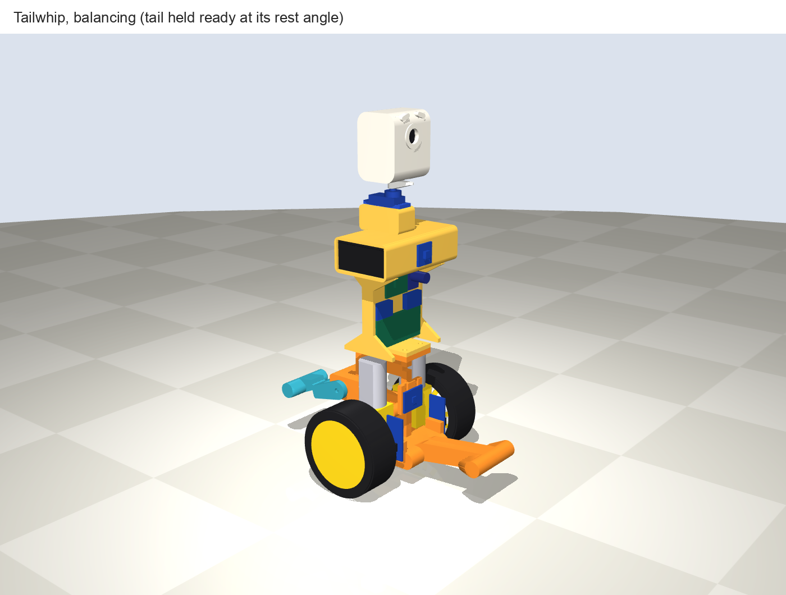
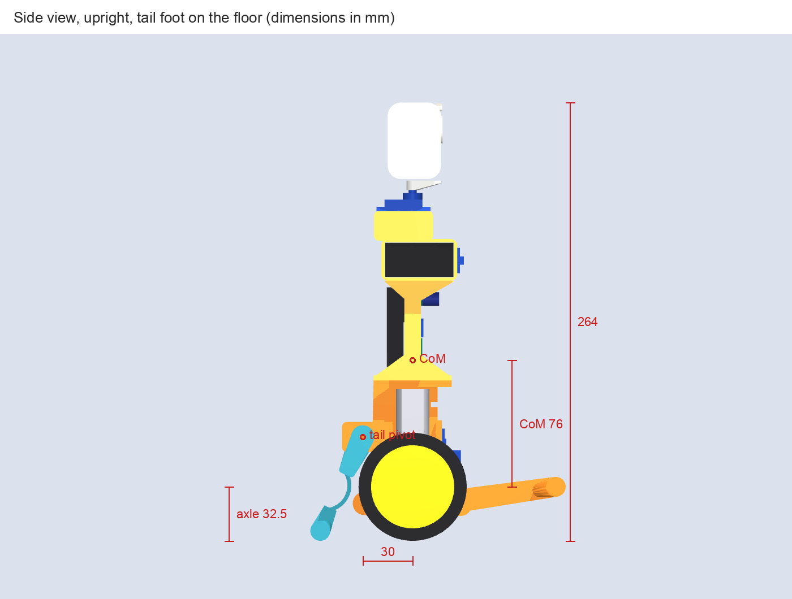
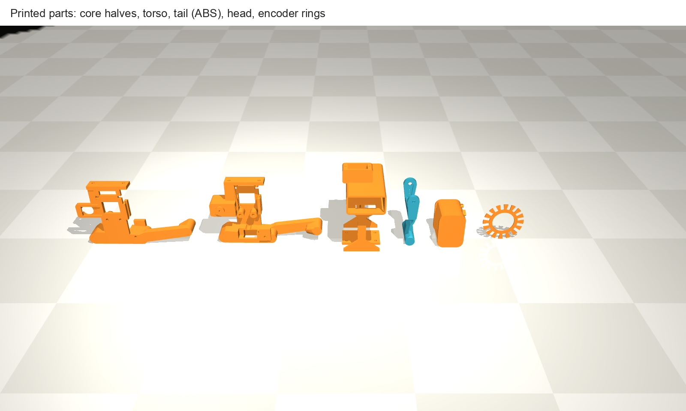

# Tailwhip mechanical design, rev B

> **AI-generated and unbuilt.** Nothing here has been printed, assembled or measured. Every number is tagged
> in `cad/tailwhip.py` as [D] datasheet, [E] estimate or [C] chosen, and every result inherits those tags.
> Measure the parts listed under "Before you print" first; the TT motor numbers are the biggest risk.

Rev B is rev A plus one change the MuJoCo model forced: how the robot stops a fall (see "Falls: what the
simulator found" below). Wiring is in `docs/electronics.md`, the code in `docs/software.md`, the simulator and
training in `sim/`.



## Files

| Path | What it is |
|---|---|
| `cad/tailwhip.py` | Every dimension (tagged), every printed and bought part, the joints and the pose maths |
| `cad/analysis.py` → `cad/out/analysis.md` | Mass and centre-of-mass table, interference, tail sweep, rest angles, tail torque, leaf spring, bed fit, PASS/FAIL table |
| `cad/export.py` → `cad/out/` | `print/*.stl` in print orientation, assembled GLB/STL (upright and at rest), `groups/*.glb` for Blender and the simulator, renders |
| `visual/motion.py`, `visual/blender_animate.py` | The demo act as kinematic poses, rendered in Blender (the video is kept out of git; it is on the website) |

Regenerate everything:

```bash
cd cad && python analysis.py && python export.py
```

## The layout in one paragraph

The two TT motors stand **vertically**, back to back, shafts on the axle and cans pointing up the body. Two
M3 x 70 bolts pass through both gearboxes and a central printed web, so one bolt pair holds both motors and the
body is only 65 mm wide between the wheels. Behind the motor cans sits the hip block with the tail servo; its
shaft is 30 mm behind and 30 mm above the axle. Below the motors a skid runs forward into two long, low
**feet** that reach 86 mm ahead of the axle. A printed spine rises from the motor web carrying the ESP32 on its back face and the power
boards on its front face, and the battery sleeve sits **on top** of the spine, under the head, to raise the centre
of mass. The pan servo sits on the sleeve roof and carries the ESP32-CAM head.

| | Value | Source |
|---|---|---|
| Height, floor to top of head | 264 mm | [C], SPEC 220-280 |
| Width over the tyres / track | 123 / 97 mm | [C] |
| Front to back (upright, feet to tail) | 134 mm | [C] |
| Mass | **394 g** | [E], SPEC target 250-270 (see below) |
| Centre of mass above the axle | 74 mm | [E], SPEC 70-90 |
| Rest on the tail | 25 deg back, tail servo at 73.6 deg | [C] |
| Where a fall stops: back (on the tail) / forward (on the feet) | 25 / 18 deg | CAD and MuJoCo, SPEC <= 50 |



## Decisions and why

**Vertical motors.** Lying the TT motors horizontally puts 59 mm of motor behind the axle, exactly where the
tail needs to be. Standing them up keeps the footprint 80 mm deep, puts 14 g of can 43 mm above the axle
(helps the centre of mass), and lets one bolt pair clamp both gearboxes to the split web. The inner shaft stubs
need 9.1 mm each [E], so the gearboxes sit 13.5 mm either side of the centre line.

**Tail pivot high and back.** With free wheels the foot carries a vertical force N set by moments about the
axle, and the servo torque is N times the foot's horizontal distance from the **pivot**, not from the axle. A pivot
at (-30, +30) mm makes that lever short. Peak torque to rear up from 25 deg is **0.060 N m** against about
0.12 N m for the SPEC's m g h sin(theta) formula, which is 2.2x margin on a clone SG-90 (~0.13 N m [E]) and 3x on
the datasheet 0.18 N m. The torque falls to zero as it reaches upright (table in `cad/out/analysis.md` section 4).
Driving the wheels backwards while rearing up adds to this; that is left for the policy.

**Feet in front, tail behind.** A bumper only stops a fall if it touches down far beyond the centre of mass;
see the next section. The feet stop a forward fall at 18 deg with 57 mm to spare, and getting up off them
needs only 2.2 m/s2 of axle acceleration (tyre friction 0.22). The tail, held at its rest angle while the robot
balances, stops a backward fall at 25 deg. The small heel and chin on the skid stay as scuff guards.

**Battery on top.** With the cells at mid-body the centre of mass was 60 mm up. On top of the spine it is 74 mm.
That slows falls (SPEC's intent) at the cost of a larger holding torque: about 0.29 sin(theta) N m.

## Falls: what the simulator found

Rev A had a rounded heel and chin under the motors, and the static check said the robot would come to rest on
them at 37 and 36 deg. The MuJoCo model disagreed: every fall, even a gentle topple, rolled straight over them
onto its back or face. The heel and chin sit almost under the centre of mass, and a falling robot carries far more
energy (its centre of mass drops about 24 mm) than the few millimetres it takes to tip over a contact that close.
A second attempt with a bar 72 mm out in front and rails 76 mm behind failed the same way.

What works is a contact far beyond the centre of mass, reached early in the fall:

- **Forward: the feet.** A bar 86 mm ahead of the axle at axle height touches at 18 deg, 57 mm beyond the centre
  of mass. In `sim/test_falls.py` it holds every forward fall up to a 6 rad/s shove with the motors off.
- **Backward: the tail.** Held at its rest angle (73.6 deg) while balancing, the foot is 39 mm off the floor and
  lands at 25 deg, 88 mm behind the axle. It holds every backward fall up to a 4 rad/s shove with the motors off.
  Above that the wheels have to help, which the trained policy does.
- **Never stow the tail up the back.** With the tail at 150 deg a gentle topple ends flat on its back. The
  firmware's failsafe and the policy's reward both keep it down.

The lesson for anyone adapting the design: check bumpers with a dynamic simulation, not just the first point
that touches.

**Tail with a C-shaped leaf spring.** ABS, 14 mm wide, 2.4 mm thick, about 41 mm of arc: 0.66 N m/rad [E].
At servo stall it bends 16 deg at 13 MPa (safety factor 2.1 on printed ABS). The fork grips the servo horn on one
side and an M3 shoulder screw into the hip block on the other, so landing loads do not hang off the spline alone.
The foot is a 40 mm wide rounded pad; glue a strip of bicycle inner tube to it for grip.

**Encoder rings, not a disc on the shaft.** There is no room for a disc on either shaft stub. A 1.2 mm printed
ring with 16 windows is glued to the inside face of each wheel; a TCRT5000 line-follower module on a post at
(x 22, z 0) reads it through a 2.5 mm gap. 32 edges per turn = 6.4 mm of travel per edge, speed only, sign from
the command (as SPEC section 6 says).

**IMU on the motor web.** The GY-521 zip-ties to a pad on the front edge of the web, 19-35 mm above the axle,
on the stiffest part of the robot.

## Where the design departs from the SPEC

| SPEC | Rev A | Why |
|---|---|---|
| Mass 250-270 g | 394 g [E] | The bought parts alone are ~297 g [E]: two 18650s 92 g, two TT motors ~58 g, two wheels ~44 g, holder 14 g, servos 18 g, boards and wiring ~70 g. Printed parts are 97 g. Every torque in the analysis and the simulator uses 394 g, and all checks still pass. Weigh the real parts; the cells and wheels are the uncertain ones. |
| Battery "mid-body" | Top of the spine | Needed to reach the 70-90 mm centre of mass |
| Rounded back and chin bumpers at ~50 deg | Feet at 18 deg, tail at 25 deg | Bumpers near the body don't stop a dynamic fall (above) |
| Parts list | Adds a 2 x 18650 holder (~$2), a slide switch and a polyfuse (~$1) | The cells need a holder and the pack needs a switch. Buy total now ~$12, inside the $15 |
| Hardware | 2 x M3 x 70 (or M3 threaded rod), 4 x M3 x 10 + nuts, 1 x M3 shoulder screw ~8 mm shoulder, servo screws | Assumed on hand; add to the BOM if not |

## Before you print: measure these

The geometry is parametric; edit the numbers at the top of `cad/tailwhip.py` and rerun.

1. **TT motor:** gearbox thickness along the shaft (`TT_T`, 18.8 assumed), width (`TT_W`, 22.5), shaft to gearbox
   end (`TT_SHAFT_END`, 11), stub length beyond each face (`TT_STUB`, 9.1), and **the two mounting holes**
   (`TT_HOLES`, assumed at x +-8, z 18 from the shaft). These are guesses from typical drawings.
2. **TT wheel:** outer diameter, width, how deep the hub goes on the shaft (`WHEEL_IN`).
3. **SG-90:** case length, thickness, tab height, spline height (clones vary +-0.5 mm).
4. **Battery holder:** outer size (`HOLDER`, 41 x 77.5 x 20.5 assumed).
5. **IR module:** where the TCRT5000 sits on its PCB; the post assumes it lands at (x 22, z 0).

Then print `core_left` first and check the motor fit before printing the rest.

## Print settings

| Part | Material | Settings | Orientation |
|---|---|---|---|
| core_left, core_right | PLA | 0.2 mm layers, 3 walls, 20 % gyroid | flat on the cut face (y = 0), no supports |
| torso | PLA | 0.2 mm, 3 walls, 20 % gyroid | upright, tree supports under the battery-sleeve floor |
| tail | **ABS** | 0.2 mm, **4 walls** (so the 2.4 mm leaf is all perimeters), 40 % infill, enclosure or draft shield | on the horn-arm face so each layer is a whole C of the leaf; tree supports under the pivot arm |
| head | PLA | 0.2 mm, 2 walls, 15 % | on its open back, no supports |
| encoder_ring x 2 | white PLA | 0.2 mm, solid | flat |

All parts fit the Ender 3 bed; the longest are the core halves at 134 x 24 x 82 mm (the feet are part of them).



## Assembly

1. **Motors to the core.** Lay `core_right` on the bench, drop the right TT motor (can up, shaft on the axle hole
   line) onto its bosses, add `core_left` and the left motor, and push two M3 x 70 bolts through all four
   layers (motor, half, half, motor). Nuts on the far side, snug, not tight. Zip-tie each can through the strap
   slots.
2. **Tail servo.** Before closing the halves fully, seat the SG-90 in the hip pocket with its spline on the +y
   (left) side and its lead out of the front; screw its tabs into the right half.
3. **IMU.** Zip-tie the GY-521 to the pad on the front of the web, chip facing forward, x axis up the body.
4. **IR sensors.** Screw each TCRT5000 module to its post (M3), sensor facing out at the wheel, and set the gap to
   the ring at about 2.5 mm.
5. **Encoder rings and wheels.** Glue a ring centred on the inside face of each wheel (CA glue), then push the
   wheels onto the shafts and fit the wheel screws.
6. **Torso.** Wire the boards to the spine first (ESP32 on the back, module towards the plastic; BMS, two
   Mini360, MX1508, capacitor and switch on the front, zip ties through the slot pairs), then bolt the torso
   to the core flange with four M3 x 10 into the captured nuts.
7. **Battery.** Slide the holder into the sleeve from the side, cells in, and strap it through the floor windows.
   Charge in place through the BMS.
8. **Head.** Screw the pan servo into the block on the sleeve roof, centre it, fit the single-arm horn pointing
   forward, screw the head to the horn, and slide the ESP32-CAM down between the ridges, lens in the eye.
9. **Tail.** Command the tail servo to 90 deg, then fit the single-arm horn into the tail's pocket with the tail
   pointing straight back along the body's -x axis, screw it to the spline, and fit the M3 shoulder screw through
   the pivot arm into the hip block. Servo angle then equals tail angle in the table below.

## Tail commands

| Pose | Tail angle (deg, 0 = straight down the body, + = backwards) |
|---|---|
| Foot on the floor with the body upright | 24.3 |
| Rest, body 25 deg back | 73.6 |
| Held while balancing (ready to catch) | 73.6, the same as rest |
| Never use: stowed up the back | 150 (a fall from here ends flat on its back) |
| Free range in the CAD (no collisions) | 20 to 180 |

An SG-90 gives about 180 deg of travel, so the used range 20-150 deg fits with margin at both ends. Trim the offset in firmware.

## Known weaknesses

- **Landing loads.** A fall from upright onto the tail stores up to ~26 mJ; if the leaf takes all of it the peak
  moment through the servo gears is about the stall torque, spread over ~30 ms. Plastic SG-90 gears may still
  strip; the MG90S is the drop-in fix (same pocket).
- **Bolt-clamped motors.** The two M3 x 70 bolts are the only thing holding the motors to the frame. If the
  gearboxes flex, add a second strap round the cans.
- **Wheels get the ring glued on**, so a wheel swap means a new ring.
- **Torque numbers are quasi-static** with free wheels. Real rear-ups are dynamic; the MuJoCo model
  (`sim/`) is the dynamic check and the trained policy rears up with the same servo limits.
- **The feet stick out 54 mm past the tyres.** They catch on door sills and cables. They also stop it leaning
  forward more than 18 deg, which caps how hard it can brake from a forward run.

## The animation

`visual/motion.py` turns the intended behaviour into poses (rest, drive on the tail, look around, rear up, balance,
drive, get hit by a ball, catch itself on the tail, get up, lie down). The wheels roll without slipping and the foot
stays planted while it rears up, using the same geometry as the CAD, but the timing is hand-chosen: it shows what
the robot should look like, not what a controller can do. `visual/blender_animate.py` renders it and saves the
`.blend` next to the video so the scene can be tweaked by hand.

```bash
python visual/motion.py
blender -b -P visual/blender_animate.py -- OUT_DIR
```
