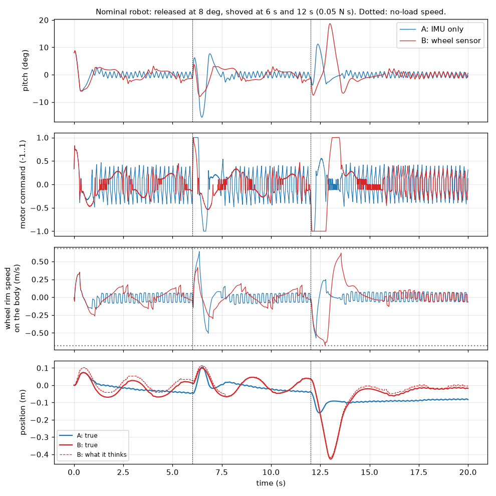

---
# The stage 1 build guide. site/build_site.py renders it as stage1.html; the format is described there.
# Every number comes from a stage 1 file through a fact below; nothing here is measured.
slug: stage1
nav: Stage 1
title: Stage 1: the bare-minimum balancer
lede: Build this before the full Tailwhip. One TT motor, two wheels, an ESP32, an IMU and a PID loop, step by step from an empty desk to a robot that balances.
reference: stage1-print | Mechanical | docs/mechanical.md | fold=Files;What changed | viewer=out/print/*.stl | lede=The printed parts, print settings, board mounts, wire routes, fasteners and the assembly in full.
reference: stage1-wiring | Electronics | docs/electronics.md | fold=What changed;Firmware notes;Sources | lede=The circuit, every wire end to end, the current budget, battery safety and the power-up checklist with a meter reading at each step.
reference: stage1-firmware | Firmware and tuning | README.md#Firmware;Bring-up;Risks | lede=What the firmware does, the bring-up and tuning notes, and the known risks of the design.
reference: stage1-sim | Simulation | README.md#What the simulation says + out/sim.md | lede=What the MuJoCo model of stage 1 predicts, and how much margin the TT motor has.
reference: stage1-design | Design check | out/design.md | lede=The generated design check: masses, balance, falls, clearances, bed fit, wall thickness and fall loads.
fact: cost = README.md: \*\*about (\$\d+)\*\*
fact: charger = README.md: An (\S+ V \S+ A Li-ion charger) is about
fact: charger_cost = README.md: charger is about (\$\d+) more
fact: mass = out/design.md: \*\*Total\*\* \| \| \*\*(\d+)\*\*
fact: height = out/design.md: (\d+) mm tall
fact: prints = README.md: \*\*(\w+) printed parts
fact: stays_up = out/results.json: $modes.A.robust.survived
fact: robots = out/results.json: $modes.A.robust.n
fact: cells = docs/electronics.md: Each cell, out of the holder \| [^|]* \| ([^|]+?)\.? \|
fact: wheel_gap = docs/mechanical.md: the gap to the cheek is ([\d.]+ mm)
fact: jb = docs/electronics.md: before it goes on the robot: (.+?); VB to GND never
fact: short = docs/electronics.md: \*\*Under (\d+ \S+): a short
fact: buck = docs/electronics.md: then \*\*([\d.]+ ± [\d.]+ V)\*\*
fact: motor_a = docs/electronics.md: MOTOR-A: (\d+ V) \(
fact: arm_deg = firmware/stage1_balance/stage1_balance.ino: ARM_DEG = (\d+)(?:\.0)?f
fact: arm_ms = firmware/stage1_balance/stage1_balance.ino: ARM_MS = (\d+)
fact: fall_deg = firmware/stage1_balance/stage1_balance.ino: FALL_DEG = (\d+)(?:\.0)?f
fact: wobble = README.md: About \+-(\d+ degrees? at \d+ Hz)
fact: drift = README.md: it drifts (about \d+ cm in \d+ s)
fact: windows = docs/mechanical.md: (\d+)[- ]window || stage1.py: (\d+)[- ]window || docs/electronics.md: (\d+)[- ]window
fact: sensor_gap = docs/mechanical.md: \*\*([\d.]+ mm)\*\*, the TCRT5000's peak
fact: ring_gap = docs/mechanical.md: Ring to the core \| ([\d.]+ mm)
fact: b_turn = docs/electronics.md: \| B3 \|[^|\n]*\|[^|\n]*\| ([^|\n]+?) \|
fact: enc_pin = docs/electronics.md: to \*\*ESP32 GPIO(\d+)\*\* || firmware/stage1_balance/stage1_balance.ino: PIN_[A-Z_]*(?:ENC|WHEEL|IR|SPEED|SENS|TCRT)[A-Z_]*\s*=\s*(\d+) || docs/electronics.md: TCRT5000[^\n]*?(?:GPIO|IO) ?(\d+) || docs/electronics.md: (?:GPIO|IO) ?(\d+)[^\n]*TCRT5000
---
**What it is.** One dual-shaft TT gearmotor with a wheel on each end, two 18650 cells on top, an ESP32, an MPU-6050 and an MX1508 motor driver, held upright by a PID loop.

**What it proves.** That a TT motor is fast enough to keep a body upright. The full robot depends on that, so you find out here, with a smaller and cheaper robot.

[[facts Parts=about {{cost}} | Prints={{prints}} in PLA | Mass=about {{mass}} g | Height={{height}} mm | Stays up (sim)={{stays_up}} of {{robots}} robots]]

[[status README.md | Read this first: designed and simulated, not built]]

**Two milestones, one build.** Milestone A balances on the IMU alone. Milestone B adds one wheel speed sensor so it also holds its position. The sensor plugs in: unplugged, the robot runs exactly as in milestone A.

[[para README.md | Stage 1 passes when | Pass criteria]]

Each step has one thing to do and one check. Do not start the next step until the check passes.

# Milestone A: balance on the IMU

## Buy the parts


Order everything on this list; the prices are pack prices, so check them. The cells must be a matched pair of genuine high-drain 18650s.
Add a {{charger}} if you have none: about {{charger_cost}}.

[[table README.md | Parts]]

**Check:** measure each cell with a meter: {{cells}}.

**If it does not work:** do not use that cell. See [battery safety](stage1-wiring.html#battery-safety-and-charging).

## Measure, then print


Measure your gearbox, wheels, boards and battery holder against [this list](stage1-print.html#before-you-print-measure-these); if one differs, change it in `stage1.py` and rerun it. Print `core_left` first, then the rest, each STL as it lies.

[[stl out/print/*.stl !out/print/*ring*.stl]]

[[table docs/mechanical.md | Print settings]]

**Check:** the gearbox drops into `core_left`, the two steel pins go through it, and a wheel on the stub clears the cheek (the gap is {{wheel_gap}}).

**If it does not work:** see [print settings](stage1-print.html#print-settings) (holes, bridges, first layer).

## Assemble the core and wheels


Solder the leads and capacitor C3 to the motor tabs and crimp on the K1 plug. Clamp the motor between the core halves with the steel pins and four bolts, tightened evenly.
Screw the IMU to the front of the core, chip forward, X arrow up. Push a wheel onto each end of the shaft.

**Check:** spin each wheel by hand. Nothing touches.

**If it does not work:** see [assembly](stage1-print.html#assembly).

## Build the boards onto the mast


Build the [junction board](stage1-wiring.html#build-the-junction-board) JB on scrap perfboard. Fit the ESP32, MX1508 and Mini360 to the back of the mast and the BMS, switch and JB to the front, each with one zip tie. Screw the mast to the core and the tray on top. No cells yet.

**Check:** before JB goes on the robot, measure it on ohms: {{jb}}.

**If it does not work:** see [board mounts](stage1-print.html#board-mounts).

## Wire it

[[svg docs/wiring.svg | Every wire, on the robot]]

Wire it from this drawing, one wire at a time, in its colours. Leave K1 (motor) and K2 (power) unplugged. The IMU takes four jumpers:

[[table README.md | Electronics]]

**Check:** meter on ohms across the robot side of K2: the reading climbs and settles in the kΩ range or higher. Under {{short}} is a short: find it.

**If it does not work:** see the [full wire list](stage1-wiring.html#wire-list) and the [schematic](stage1-wiring.html#how-it-works-block-diagram-in-words).

## Power it up safely


Read [battery safety](stage1-wiring.html#battery-safety-and-charging) first. Fit the cells, wire the BMS B-, then BM, then B+. Plug K2 and switch on, with the Mini360 output (W15, W16) still off the ESP32: it ships set to a random voltage that can kill one. Turn its pot until the output is right.

**Check:** the Mini360 output reads {{buck}}, and the MX1508 MOTOR-A pads read {{motor_a}}.

**If it does not work:** follow the [power-up checklist](stage1-wiring.html#power-up-checklist), which has a reading for each connection.

## Flash the firmware

Switch off and push the remaining jumpers onto the ESP32 (power-up step 6). Plug in USB with the battery on only if your board passed the [diode check](stage1-wiring.html#esp32-pin-map). With `arduino-cli` and the esp32 core [installed](electronics.html#set-up-the-firmware-toolchain), from the top of the repository:

```bash
arduino-cli compile -b esp32:esp32:esp32 stage1/firmware/stage1_balance
arduino-cli upload  -b esp32:esp32:esp32 -p /dev/cu.usbserial-XXXX stage1/firmware/stage1_balance
arduino-cli monitor -p /dev/cu.usbserial-XXXX -c baudrate=115200
```

[[file firmware/stage1_balance/stage1_balance.ino | stage1_balance.ino on GitHub]]

**Check:** the start-up message does not say `MPU-6050 not found`. Type `show`: held upright, pitch reads near 0; tilted forward, pitch goes positive.

**If it does not work:** see [IMU wiring](stage1-wiring.html#imu-wiring) and [troubleshooting](stage1-wiring.html#troubleshooting).

## Check the motor


Switch off, plug in K1, and stand the robot with its wheels off the ground. Type `motor 0.3 1000`, then `motor -0.3 1000`. If the tyre top moves backward on the first, type `dir -1`, then `save`.
Run `motor 1 3000`, count the wheel turns and note the no-load speed for the simulator.

**Check:** the wheels turn each way, forward for the positive command, and the serial monitor shows no reset messages.

**If it does not work:** see [troubleshooting](stage1-wiring.html#troubleshooting) and [the MX1508](stage1-wiring.html#mx1508).

## First balance

[[video stage1_sim | The same robot in the simulator, released at an angle and shoved twice.]]

On a flat floor, hold it upright and still while you switch on: the LED goes solid when the gyro is calibrated.
Keep holding it within {{arm_deg}} degrees of upright for {{arm_ms}} ms and the controller takes over. Past {{fall_deg}} degrees it lets go and waits.

**Check:** let go gently. It stands on its own, wobbling a little.

**If it does not work:** if it creeps away, falls slowly or shakes, go on to the next step: it sets the trim and the gains.

## Tune it and test it



[[para README.md | Tune: creeps one way]]

Then log a run and compare it with the plot above:

[[para README.md | `stream 1`]]

The simulator expects a wobble of about {{wobble}}.
It has no wheel sensor yet, so it wanders: the simulator says {{drift}}.

**Check:** it meets the pass criteria at the top of this guide. That is milestone A.

**If it does not work:** see the [tuning notes](stage1-firmware.html#bring-up) and [the simulation](stage1-sim.html).

# Milestone B: hold position

One TCRT5000 IR sensor reads a printed ring on the inside of the left wheel, so the firmware knows how far the robot has rolled and can bring it back. Start only after milestone A passes.
The ring has {{windows}} windows, and the sensor's output goes to ESP32 GPIO {{enc_pin}}.

## Buy, print and fit the sensor


[[table docs/electronics.md | Parts (milestone B)]]

[[stl out/print/*ring*.stl]]

Print the ring in matte black PLA. The TCRT5000 comes off its module board and sits in the clip under the core on a short four-wire pigtail, {{sensor_gap}} from the ring; the board goes on the back of the core. The ring is glued to the inside face of the left wheel. The [fitting steps](stage1-print.html#milestone-b-the-wheel-sensor) have the order; the core does not come apart.

**Check:** spin the left wheel by hand. Nothing touches; the ring runs {{ring_gap}} from the core.

**If it does not work:** see [milestone B, mechanical](stage1-print.html#milestone-b-the-wheel-sensor).

## Wire the sensor

Make the K3 lead (two Y-leads and R5, C4 at the plug) off the robot and plug it in as in [fitting it](stage1-wiring.html#fitting-it-no-soldering-on-the-robot). VCC goes to 3V3, never 5V:

[[table docs/electronics.md | What it is]]

Then [set the trimmer](stage1-wiring.html#adjusting-the-trimmer) so the module's D0 LED follows the windows.

**Check:** turn the left wheel exactly one turn by hand: {{b_turn}}

**If it does not work:** see [power-up, milestone B](stage1-wiring.html#power-up-milestone-b) and [troubleshooting](stage1-wiring.html#troubleshooting).

## Hold position

Balance it as in milestone A. With the sensor plugged in, the firmware detects it and holds position; unplugged, it behaves as in milestone A.

[[para README.md | Milestone B passes when | Pass criteria, milestone B]]

**Check:** leave it standing for a minute. It sways slowly but stays near where it started instead of wandering off across the floor.

**If it does not work:** see the [firmware and tuning notes](stage1-firmware.html) and the [simulation](stage1-sim.html).
