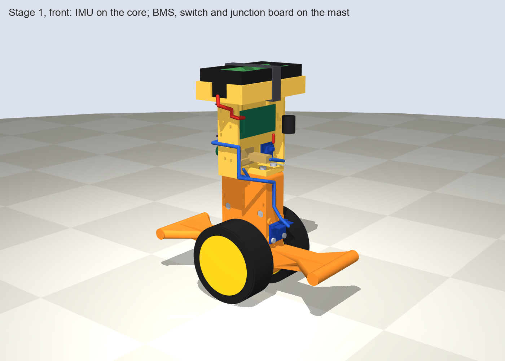
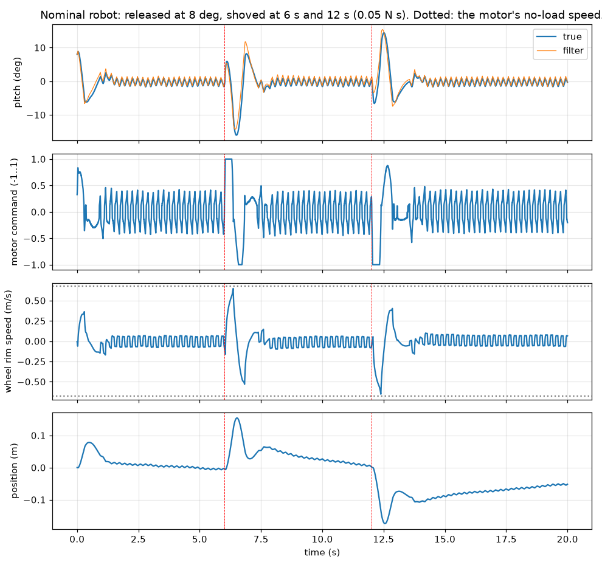
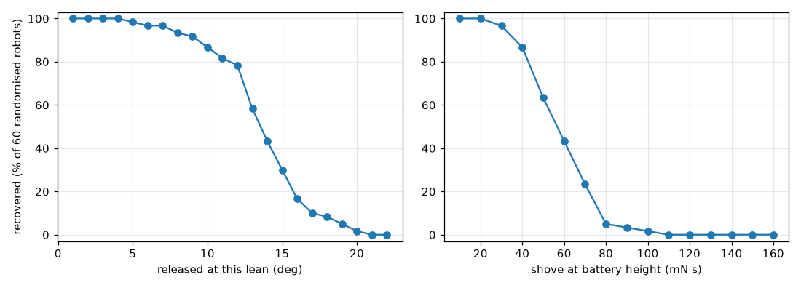
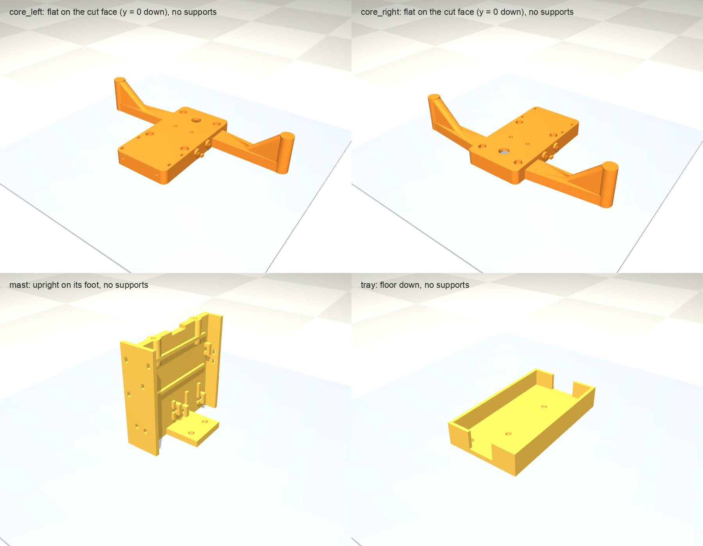
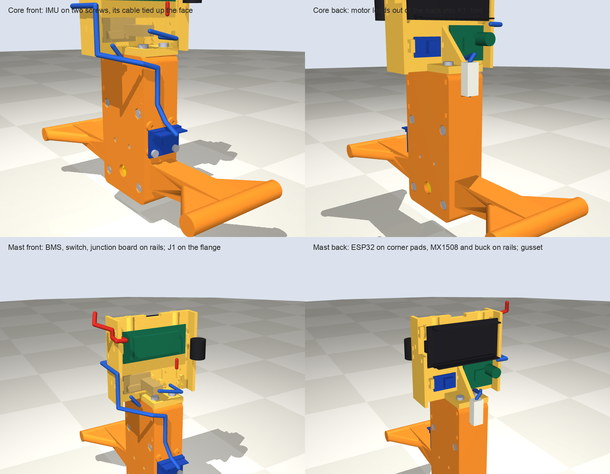
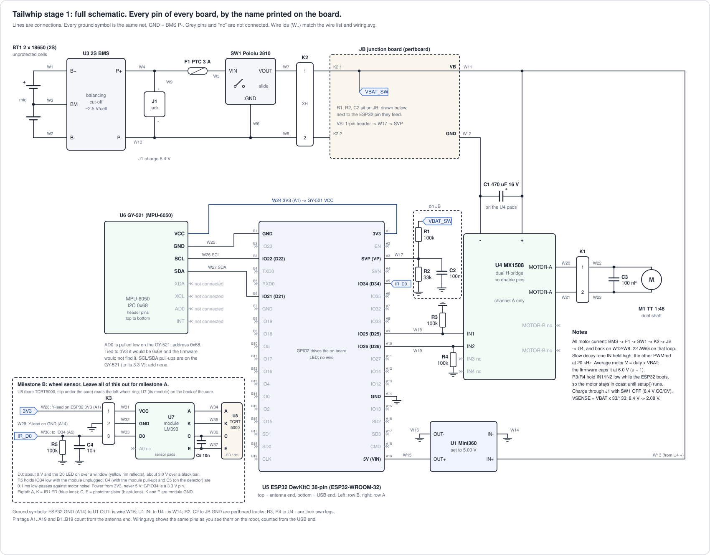
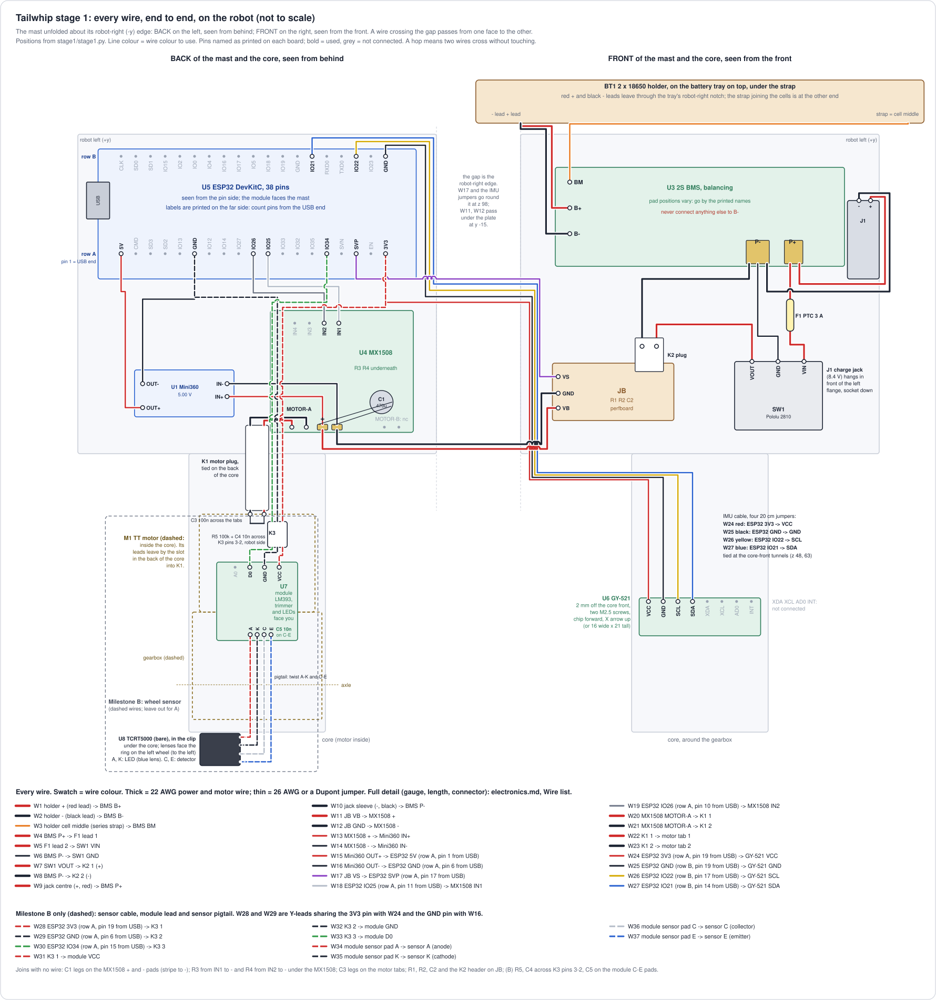

# Stage 1: the bare-minimum balancer

Build this before the full Tailwhip. One TT motor, a wheel on each end of its shaft, two 18650s on top, an ESP32,
an IMU and a motor driver. One question: **is a TT motor fast enough to keep a body upright with a PID loop?**

**Status:** designed and simulated. Not printed, not built. The firmware compiles for the ESP32 but has not run
on hardware. Every motor and mass figure is an estimate carried over from the published Tailwhip.

## The three stages

| Stage | Robot | Proves | Adds |
|---|---|---|---|
| **1 (this)** | One TT motor, two wheels on one shaft, PID | A TT motor can balance a body at all | Nothing: the minimum |
| 2 | Two TT motors, body held at a lean, a fixed weight on a bar or tail | The body can stand at an angle if a weight balances it; steering | Second motor, wheel sensors, the bar |
| 3 | The full Tailwhip | A moving tail as the counterweight; creature behaviours | Four servos, shells, learned control |

Each stage reuses the one before: stage 1's core, electronics and firmware carry into stage 2.

**Stage 1 passes when** the real robot stands for 60 s on a flat floor, recovers when released from 8 degrees,
and survives light pokes; and its measured wobble, motor speed and dead zone have been fed back into `sim.py`.

## What the simulation says

Full results: `out/sim.md`. Clip: `python sim.py video out.mp4`.

- **It balances.** The nominal robot stands, recovers from a release at 13 degrees either way, and takes a
  50 mN s shove at battery height (a 50 g ball arriving at 1 m/s).
- **Left alone, 60 of 60 randomised robots stand for 20 s.** With a random start lean and two shoves of
  20-50 mN s, 257 of 300 (86 %) stay up. Nine in ten recover from a 9 degree release and a 30 mN s shove.
- **The TT's speed is enough, with a little to spare.** A shove uses up to 0.65 of the 0.68 m/s available.
  A 30-60 rpm gearmotor recovers from nothing in the same model; the TT's 200 rpm gets 14 degrees in that sweep.
- **Torque, not speed, is the tighter limit.** Doubling the stall torque takes the recoverable lean from 14 to
  20 degrees. That is the case for stage 2's second motor.
- **A lower battery helps.** This was the surprise: with the centre of mass 66 mm above the axle instead of
  86 mm it recovers 16 degrees, not 14, because the motor has less to hold. The mast could be 20 mm shorter.
- **It will wobble.** About +-1 degree at 4 Hz, from the 5 degrees of slop in the gearbox. That is normal for a
  TT balancer, and it is the first thing to compare against the real robot.
- **It will wander.** There are no wheel sensors, so it drifts about 40 cm in 20 s. Stage 2 fixes that.
- **Getting up by itself is a coin toss.** A fixed kick off the crash bar works for the nominal robot and 57 %
  of the randomised ones. Stand it up by hand.

Not covered: the model is left-right symmetric, so nothing tests the narrow track. See risks.

## Mechanical

Full write-up: `docs/mechanical.md`. Design check (22 checks, all pass): `out/design.md`. Geometry: `stage1.py`.
Print files: `out/print/`.

| Quantity | Value |
|---|---|
| Mass | 347 g (98 g printed, 249 g everything else) |
| Size | 170 mm front to back, 86 mm wide, 189 mm tall |
| Centre of mass | 86 mm above the axle, on the axle fore-aft |
| Track | 52 mm between wheel centres |
| Fall time constant | 116 ms (a lean doubles about every 80 ms) |
| Steady lean one motor can hold | about 18 degrees |
| Rest angle when it falls | 24.7 degrees, on a crash bar |

**Four printed parts, PLA, no supports:**

| Part | Size in print pose (mm) | Mass (g) | Print |
|---|---|---|---|
| `core_left`, `core_right` | 170 x 87 x 30 each | 35.1 each | Flat on the cut face |
| `mast` | 46 x 62 x 60 | 16.9 | Upright on its foot |
| `tray` | 46 x 82 x 14 | 10.9 | Floor down |

- **Core:** a clamshell round the gearbox, split down the middle. Two 3 x 22 mm steel pins go through the
  gearbox's two M3 holes into both halves, so no screw head sits in the gap beside a wheel. Four M3 x 20 bolts
  with recessed heads and nuts pull the halves together. The crash bars front and back are part of the print.
- **Mast:** a 4 mm plate with edge flanges and a gusset, held to the core by four M3 x 12 self-tapping screws.
  ESP32, motor driver and buck on the back; BMS, switch and junction board on the front. Boards without holes
  sit on printed rails and are held by one zip tie each.
- **Tray:** carries the battery holder; two M3 x 16 self-tapping screws and a strap hold it and the cells.
- **IMU:** on the front face of the core, close to the axle, chip facing forward, on two M2.5 screws.
- **Motor:** it must be the **dual-shaft** TT gearmotor (1:48), with a wheel pushed onto each end.

## Parts

Prices are the published Tailwhip BOM's pack unit prices, mostly unconfirmed.

| Part | Qty | About |
|---|---|---|
| Dual-shaft TT gearmotor 1:48 | 1 | $3.00 |
| 65 mm TT wheel | 2 | $4.00 |
| ESP32 DevKit (classic WROOM-32) | 1 | $7.00 |
| GY-521 MPU-6050 | 1 | $2.60 |
| MX1508 motor driver | 1 | $1.60 |
| Mini360 buck (set to 5.0 V) | 1 | $0.90 |
| 2S BMS with balancing | 1 | $1.60 |
| 2 x 18650 holder, series | 1 | $1.75 |
| 18650 cells | 2 | on hand |
| PTC fuse 3 A, power switch | 1 each | $1.30 |
| 470 uF 16 V, 100 nF (2), 100k (3), 33k | | $0.95 |
| JST-XH 2-pin pair | 2 | $1.60 |
| DC 5.5 x 2.1 mm jack on a pigtail | 1 | $0.70 |
| Perfboard scrap, header pins, four 20 cm jumpers | | $1.35 |
| M3 x 20 + nuts (4), M3 x 12 self-tap (4), M3 x 16 self-tap (2), M2.5 x 8 self-tap (2), 3 x 22 mm pins (2) | | $2.00 |
| Zip ties (12), 10 mm strap, wire | | $2.00 |
| PLA | 98 g | $1.60 |
| **Total** | | **about $34** |

An 8.4 V 1 A Li-ion charger is about $10 more if you do not have one.

## Electronics

Full design: `docs/electronics.md` (power budget, protection, pin map, 27-wire list, power-up checklist).
Regenerate the diagrams with `python docs/tools/gen_electronics.py`.

The IMU takes four wires:

| GY-521 pin | ESP32 pin |
|---|---|
| VCC | 3V3 |
| GND | GND |
| SCL | GPIO 22 |
| SDA | GPIO 21 |

XDA, XCL, AD0 and INT stay unconnected.

## Firmware

`firmware/stage1_balance/stage1_balance.ino`, board "ESP32 Dev Module". No radio, no laptop in the loop.

- 400 Hz loop: read the IMU, complementary filter for pitch, PID, one PWM pair to the MX1508.
- Arms itself when held within 5 degrees of upright for half a second; lets go past 22 degrees.
- Serial at 115200: gains, trim, direction flip, save to flash, a 50 Hz CSV stream, an open-loop motor test.
- Default gains come from `sim.py tune`: kp 1.62, kd 0.37, kv 1.94, kx 0.11 (per rad, rad/s, m/s, m).
- The filter and PID are the same code path `sim.py` simulates. Change one, change the other.

## Bring-up

1. Set the Mini360 to 5.0 V on the bench before it touches the ESP32.
2. Flash, open the serial monitor, type `show`. Tilt it forward: pitch must go positive.
3. Wheels off the ground, `motor 0.3 1000`. The wheels must turn the way that would drive it forward; if not,
   `dir -1`. Count turns in a `motor 1 3000` run to get the no-load speed.
4. Hold it upright and still through power-on (gyro calibration), then let it arm in your hands.
5. Tune: creeps one way, change `trim`; falls over slowly, raise `kp`; shakes hard, lower `kd`; runs away,
   raise `kv`. `save` when it stands.
6. `stream 1`, log 20 s, and compare the wobble with `out/plot_nominal.png`.

## Risks

1. **Narrow track.** 52 mm between wheel centres; it tips sideways past about 20 degrees of roll. Flat floor only.
2. **Estimates.** Stall torque (0.08 N m), no-load speed (200 rpm), slop (5 degrees) and dead zone are guesses
   until bench step 3. The torque sweep shows the result is sensitive to the first.
3. **Cheek plates.** The core is 2.3 mm thick where it passes between the gearbox and each wheel.
4. **No steering.** Both wheels are on one shaft. It goes where it is pointed.
5. **Wheel fit.** Each wheel sits on 5.5 mm of a 9.1 mm stub; check for wobble.
6. **Motor driver margin.** The MX1508's weaker channel is rated below the simulated current peaks; see
   `docs/electronics.md` for the stronger channel and fallback boards.

## Files

| File | What |
|---|---|
| `stage1.py` | Geometry, mass table, design check, renders, print STLs |
| `sim.py` | MuJoCo model, the firmware's controller, gain search, all experiments, the clip |
| `firmware/stage1_balance/` | The ESP32 sketch |
| `docs/electronics.md`, `docs/schematic.svg`, `docs/wiring.svg` | Electronics design and diagrams |
| `docs/mechanical.md` | Printed parts, print settings, fasteners, assembly order |
| `out/design.md`, `out/sim.md` | Generated numbers |
| `out/gains.json`, `out/results.json`, `out/model.json` | Gains, raw results, the numbers the sim is built from |
