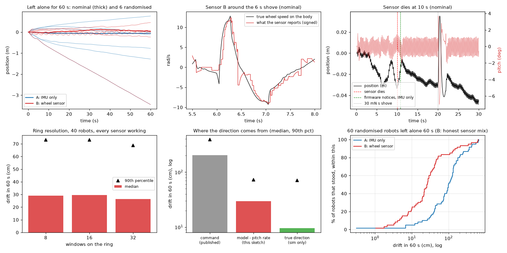
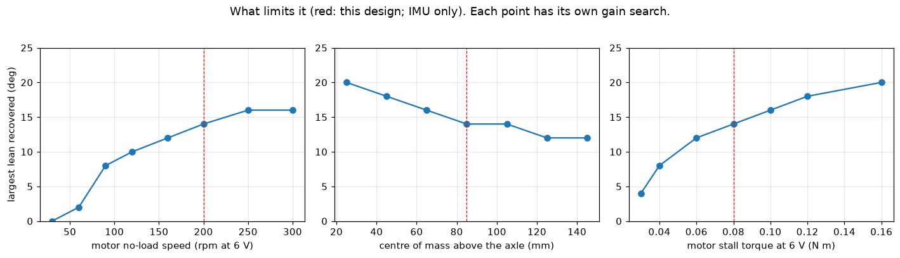
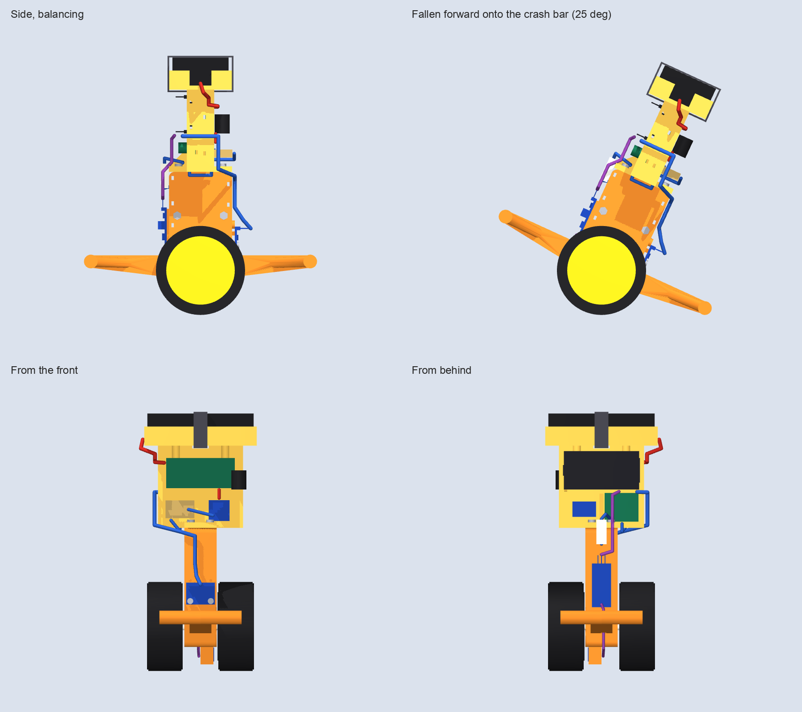

# Stage 1: the bare-minimum balancer

Build this before the full Tailwhip. One TT motor, a wheel on each end of its shaft, two 18650s on top, an ESP32,
an IMU and a motor driver; then one wheel sensor. One question: **is a TT motor fast enough to keep a body upright with a PID loop?**

**Status:** designed and simulated. Not printed, not built. The firmware compiles for the ESP32 but has not run
on hardware. Every motor and mass figure is an estimate carried over from the published Tailwhip.

## The three stages

| Stage | Robot | Proves | Adds |
|---|---|---|---|
| **1 (this)** | One TT motor, two wheels on one shaft, PID | A TT motor can balance a body at all | Milestone A: nothing, the minimum. Milestone B: one wheel sensor |
| 2 | Two TT motors, body held at a lean, a fixed weight on a bar or tail | The body can stand at an angle if a weight balances it; steering | Second motor, a second wheel sensor, the bar |
| 3 | The full Tailwhip | A moving tail as the counterweight; creature behaviours | Four servos, shells, learned control |

Each stage reuses the one before: stage 1's core, electronics and firmware carry into stage 2.

**Stage 1 passes when** the real robot stands for 60 s on a flat floor, recovers when released from 8 degrees,
and survives light pokes; and its measured wobble, motor speed and dead zone have been fed back into `sim.py`.
That is milestone A, on the IMU alone.

**Milestone B passes when**, with the wheel sensor plugged in, the robot still does all of the above and stays
within about 30 cm of where it started over 60 s.

## What the simulation says

Full results: `out/sim.md`. Clip: `python sim.py video out.mp4` (add `--sensor` for milestone B).
Numbers are for milestone A (IMU only) unless they say otherwise.

- **It balances.** The nominal robot stands, recovers from a release at 14 degrees either way, and takes a
  50 mN s shove at battery height (a 50 g ball arriving at 1 m/s).
- **Left alone, 60 of 60 randomised robots stand for 20 s.** With a random start lean and two shoves of
  20-50 mN s, 258 of 300 (86 %) stay up; with the wheel sensor, 277 (92 %). Nine in ten recover from a 9 degree
  release and a 30 mN s shove (10 degrees and 40 mN s with the sensor).
- **The TT's speed is enough, with a little to spare.** A shove uses up to 0.65 of the 0.68 m/s available.
  A 30 rpm gearmotor recovers from nothing in the same model and a 60 rpm one from 2 degrees; the TT's 200 rpm
  gets 14.
- **Torque, not speed, is the tighter limit.** Doubling the stall torque takes the recoverable lean from 14 to
  20 degrees. That is the case for stage 2's second motor.
- **A lower battery helps.** This was the surprise: with the centre of mass 65 mm above the axle instead of
  85 mm it recovers 16 degrees, not 14, because the motor has less to hold. The mast could be 20 mm shorter.
- **It will wobble.** About +-1 degree at 4 Hz, from the 5 degrees of slop in the gearbox. That is normal for a
  TT balancer, and it is the first thing to compare against the real robot.
- **It will wander.** On the IMU alone it drifts about 50 cm in 20 s and about 1 m in 60 s (medians, left alone).
- **The wheel sensor cuts the drift about four times, and no further.** With it the median is 15 cm in 20 s and
  26 cm in 60 s. One sensor cannot tell which way the wheel turns, and at a standstill most edges come from the
  body rocking over a still wheel; that, not the ring's resolution, is the limit. A second sensor a quarter of a
  window away would fix it and is not part of stage 1.
- **The sensor does not help it balance.** Its speed reading is too coarse and too late, so the balance loop still
  runs on the motor model; the sensor only counts position. With it the robot sways slowly, about 7 cm either way.
- **If the sensor fails it carries on.** The firmware notices within about a second and falls back to the IMU.
- **Getting up by itself is a coin toss.** A fixed kick off the crash bar works for the nominal robot and 57 %
  of the randomised ones (62 % with the sensor). Stand it up by hand.

Not covered: the model is left-right symmetric, so nothing tests the narrow track. See risks.

## Mechanical

Full write-up: `docs/mechanical.md`. Design check (28 checks, all pass): `out/design.md`. Geometry: `stage1.py`.
Print files: `out/print/`.

| Quantity | Value |
|---|---|
| Mass | 352 g with the wheel sensor, about 346 g without (98 g printed) |
| Size | 170 mm front to back, 86 mm wide, 189 mm tall |
| Centre of mass | 85 mm above the axle, on the axle fore-aft |
| Track | 52 mm between wheel centres |
| Fall time constant | 116 ms (a lean doubles about every 80 ms) |
| Steady lean one motor can hold | about 18 degrees |
| Rest angle when it falls | 24.7 degrees, on a crash bar |

**Four printed parts, PLA, no supports** (plus a thin ring for milestone B):

| Part | Size in print pose (mm) | Mass (g) | Print |
|---|---|---|---|
| `core_left` | 170 x 100 x 30 | about 35 | Flat on the cut face |
| `core_right` | 170 x 87 x 30 | about 35 | Flat on the cut face |
| `mast` | 46 x 62 x 60 | 16.9 | Upright on its foot |
| `tray` | 46 x 82 x 14 | 10.9 | Floor down |
| `encoder_ring` (milestone B) | 50 x 50 x 0.6 | 0.5 | Flat, matte black PLA |

- **Core:** a clamshell round the gearbox, split down the middle. Two 3 x 22 mm steel pins go through the
  gearbox's two M3 holes into both halves, so no screw head sits in the gap beside a wheel. Four M3 x 20 button-head bolts
  with recessed heads and nuts pull the halves together. The crash bars front and back are part of the print.
- **Mast:** a 4 mm plate with edge flanges and a gusset, held to the core by four M3 x 12 self-tapping screws.
  ESP32, motor driver and buck on the back; BMS, switch and junction board on the front. Boards without holes
  sit on printed rails and are held by one zip tie each.
- **Tray:** carries the battery holder; two M3 x 16 self-tapping screws and a strap hold it and the cells.
- **IMU:** on the front face of the core, close to the axle, chip facing forward, on two M2.5 screws.
- **Wheel sensor (milestone B):** the bare TCRT5000 sits in a clip under the left core half, 2.5 mm from a
  printed 16-window ring glued inside the left wheel; its module board sits on the back of the core. The left
  wheel comes off to fit it; the core stays closed.
- **Motor:** it must be the **dual-shaft** TT gearmotor (1:48), with a wheel pushed onto each end.

## Parts

Prices are the published Tailwhip BOM's pack unit prices, mostly unconfirmed.

| Part | Qty | About |
|---|---|---|
| Dual-shaft TT gearmotor 1:48 | 1 | $3.00 |
| 65 mm TT wheel | 2 | $4.00 |
| ESP32 DevKit (classic WROOM-32) | 1 | $7.00 |
| GY-521 MPU-6050 | 1 | $2.60 |
| MX1508 motor driver | 1 | $1.60 |
| Mini360 buck (set to 5.0 V) | 1 | $0.90 |
| 2S BMS with balancing | 1 | $1.60 |
| 2 x 18650 holder, series | 1 | $1.75 |
| 18650 cells | 2 | on hand |
| PTC fuse 3 A, power switch | 1 each | $1.30 |
| 470 uF 16 V, 100 nF (2), 100k (3), 33k | | $0.95 |
| JST-XH 2-pin pair | 2 | $1.60 |
| DC 5.5 x 2.1 mm jack on a pigtail | 1 | $0.70 |
| Perfboard scrap, header pins, four 20 cm jumpers | | $1.35 |
| M3 x 20 button head + nuts (4), M3 x 12 self-tap (4), M3 x 16 self-tap (2), M2.5 x 8 self-tap (2), 3 x 22 mm pins (2) | | $2.00 |
| Zip ties (12), 10 mm strap, wire | | $2.00 |
| PLA | 98 g | $1.60 |
| **Total** | | **about $34** |
| Milestone B: TCRT5000 module, JST-XH 3-pin pair, 100k, 10 nF (2), four-core wire, three 20 cm jumpers | | about $2.70 |

An 8.4 V 1 A Li-ion charger is about $10 more if you do not have one.

## Electronics

Full design: `docs/electronics.md` (power budget, protection, pin map, wire list, power-up checklist, and a
separate milestone B section for the wheel sensor).
Regenerate the diagrams with `python docs/tools/gen_electronics.py`.

The IMU takes four wires:

| GY-521 pin | ESP32 pin |
|---|---|
| VCC | 3V3 |
| GND | GND |
| SCL | GPIO 22 |
| SDA | GPIO 21 |

XDA, XCL, AD0 and INT stay unconnected.

Milestone B adds the wheel sensor: its D0 output goes to GPIO 34 and it shares the ESP32's 3V3 pin with the IMU
through a Y-lead. A 3-pin plug lets it go on and come off with no soldering on the robot.

## Firmware

`firmware/stage1_balance/stage1_balance.ino`, board "ESP32 Dev Module". No radio, no laptop in the loop.
It reads the wheel sensor on GPIO 34 if one is plugged in and working, and runs on the IMU alone if not.

- 400 Hz loop: read the IMU, complementary filter for pitch, PID, one PWM pair to the MX1508.
- Arms itself when held within 5 degrees of upright for half a second; lets go past 22 degrees.
- Serial at 115200: gains, trim, direction flip, save to flash, a 50 Hz CSV stream, an open-loop motor test,
  `edit imu|ir` to pick which gain set to change, `wnl` for the motor's no-load speed, `wheel auto|off`, and
  `ir` / `irw 1` to watch the sensor.
- Default gains come from `sim.py tune` (per rad, rad/s, m/s, m). IMU only: kp 1.62, kd 0.37, kv 2.42, kx 0.137.
  With the sensor: kp 1.79, kd 0.30, kv 2.09, kx 0.54. Both assume a no-load wheel speed of 21 rad/s (200 rpm).
- The filter, the PID and the wheel-sensor code are the same code path `sim.py` simulates. Change one, change the other.

## Bring-up

1. Set the Mini360 to 5.0 V on the bench before it touches the ESP32.
2. Flash, open the serial monitor, type `show`. Tilt it forward: pitch must go positive.
3. Wheels off the ground, `motor 0.3 1000`. The wheels must turn the way that would drive it forward; if not,
   `dir -1`. Count turns in a `motor 1 3000` run to get the no-load speed (with the sensor fitted the sketch prints
   it), then `wnl <rad/s>` and `save`.
4. Hold it upright and still through power-on (gyro calibration), then let it arm in your hands.
5. Tune: creeps one way, change `trim`; falls over slowly, raise `kp`; shakes hard, lower `kd`; runs away,
   raise `kv`. `save` when it stands. Gains apply to the set picked with `edit imu|ir`; `wheel off` tunes milestone A
   with the sensor still plugged in.
6. `stream 1`, log 20 s, and compare the wobble with `out/plot_nominal.png`.

## Risks

1. **Narrow track.** 52 mm between wheel centres; it tips sideways past about 20 degrees of roll. Flat floor only.
2. **Estimates.** Stall torque (0.08 N m), no-load speed (200 rpm), slop (5 degrees) and dead zone are guesses
   until bench step 3. The torque sweep shows the result is sensitive to the first.
3. **Cheek plates.** The core is 2.3 mm thick where it passes between the gearbox and each wheel, and 1.7 mm
   under the ring on the left.
4. **Position hold is loose.** One wheel sensor has no direction, so expect about 25 cm of wander a minute.
   The sensor also comes off its module onto a pigtail, which is fiddly soldering, and the black ring needs
   enough infrared contrast against the wheel.
5. **No steering.** Both wheels are on one shaft. It goes where it is pointed.
6. **Wheel fit.** Each wheel sits on 5.5 mm of a 9.1 mm stub; check for wobble.
7. **Motor driver margin.** The MX1508's weaker channel is rated below the simulated current peaks; see
   `docs/electronics.md` for the stronger channel and fallback boards.

## Files

| File | What |
|---|---|
| `stage1.py` | Geometry, mass table, design check, renders, print STLs |
| `sim.py` | MuJoCo model, the firmware's controller, gain search, all experiments, the clip |
| `firmware/stage1_balance/` | The ESP32 sketch |
| `docs/electronics.md`, `docs/schematic.svg`, `docs/wiring.svg` | Electronics design and diagrams |
| `docs/mechanical.md` | Printed parts, print settings, fasteners, assembly order |
| `out/design.md`, `out/sim.md` | Generated numbers |
| `out/gains.json`, `out/results.json`, `out/model.json` | Gains, raw results, the numbers the sim is built from |
