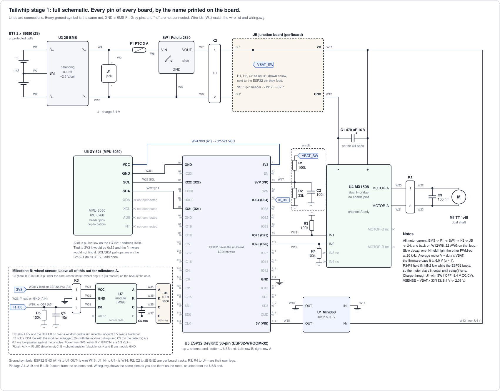
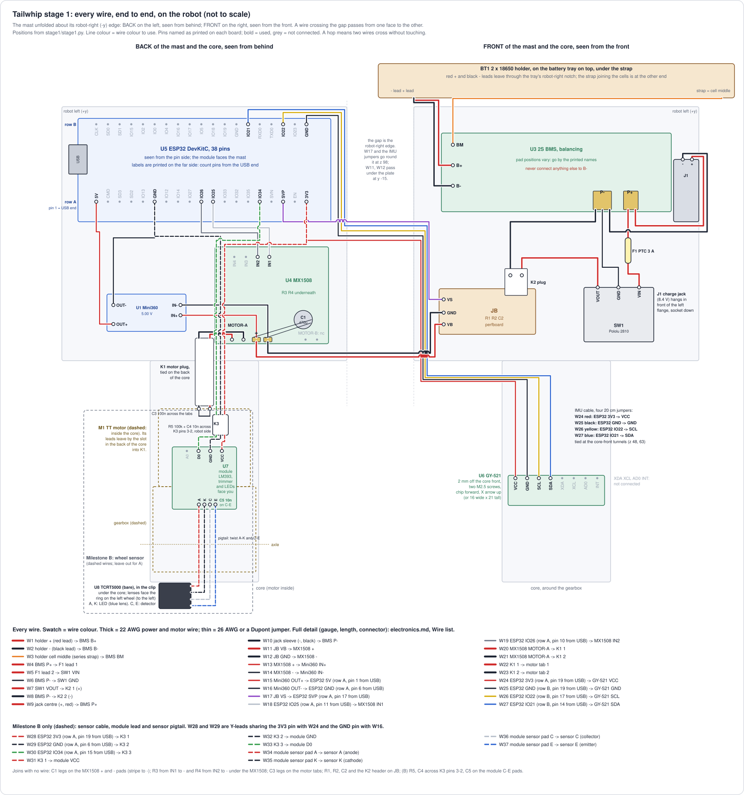

# Stage 1 electronics

> **AI-generated, designed and simulated, not built.** Nothing on this page has been wired, powered or measured.
> Every number is tagged [D] datasheet or seller listing, [E] estimate, [C] chosen by this design, or [S] from the
> stage 1 simulation (`sim.py`). The meter readings in the power-up checklist are gates: do not connect the next
> part until you get the reading the table gives.

This page covers the stage 1 balancer only: one dual-shaft TT motor, two 18650 cells, an ESP32, a GY-521 and an
MX1508. It gives you the circuit, where every wire goes on the robot, the current each part draws, and the order to
power it up in. Board positions, mounts and cable routes follow the final `stage1.py` and [`mechanical.md`](mechanical.md). The published Tailwhip's electronics page (`docs/electronics.md`) uses the same parts and the same
reference numbers where a part is shared, so stage 1 carries into stage 2 without rewiring the power section.

Drawings:

- [`schematic.svg`](schematic.svg): the full circuit, every pin of every board by the name printed on it.
- [`wiring.svg`](wiring.svg): the robot itself, both faces of the mast unfolded, with every wire drawn end to end in
  the colour to use. You should be able to wire the robot from this drawing alone.
- [`electronics.json`](electronics.json): the same model in machine-readable form (parts, every pin, nets, wires,
  ESP32 pin map, power budget).

All three come from `tools/gen_electronics.py`. It checks that every net is joined end to end by a wire or an
on-board connection (nothing implied), that every pin of every board is drawn, that the pin numbers and constants in
`../firmware/stage1_balance/stage1_balance.ino` match the circuit, and that no labels overlap.





---

## What changed from the first-pass wiring

The first pass in `../README.md` was right in its pins and its main power path. This design adds or changes:

| Change | Why |
|---|---|
| **R3, R4: 100 kΩ pull-downs on MX1508 IN1 and IN2** [C] | From reset until `setup()` runs (a few hundred ms) GPIO25 and GPIO26 are inputs with no pull [D ESP32 datasheet, IO_MUX reset state]. A floating IN pin can switch the bridge on for a moment and kick the wheel. The MX1508 may have internal pull-downs, but no datasheet available here says so for certain [E]. Two resistors make it certain: the motor stays in coast until the firmware drives the pins. |
| **C3: 100 nF ceramic across the motor tabs** [C] | Brush noise suppression at the source, as Pololu recommends for brushed gearmotors [D Pololu]. It keeps commutator spikes off the long motor leads and away from the I2C wires and the ESP32. |
| **JB, a small junction board** on the mast front [C] | The divider (R1, R2, C2) needs a home, and the battery rail needs one point where the MX1508 feed and the divider tap meet. JB carries both, plus the K2 power plug header. `stage1.py` gives it rails on the mast front. |
| **K1 and K2, two JST-XH 2-pin connectors** [C] | K1, tied to the back of the core, lets the core (motor) come off the mast; K2 separates the battery and switch from everything they feed, so each step of the power-up can be checked before the next part is connected. |
| **J1 charge jack and an 8.4 V charger** [C] | The first-pass list had no way to charge the pack in place. Same jack and charger as the published robot. |
| **The Mini360 is fed from the MX1508 pads**, not from a separate tap [C] | Shortest wires on the back of the mast. The ESP32's ground then reaches the battery through the Mini360 and the MX1508's - pad, so no motor current flows through the ESP32. |
| **IMU on 20 cm jumpers**, not 10 cm [C] | The ESP32's I2C pins are on the back of the mast, about 16 cm along the cable route from the GY-521 on the front of the core (`mechanical.md`). 10 cm jumpers do not reach. |
| **MX1508 channel A only; IN3, IN4, MOTOR-B not connected** | Stated, so nobody wonders. See "MX1508" for the case where channel A turns out to be the weak one. |
| **No firmware change** | Every pin and constant in the sketch matches this circuit; the generator checks it. Two optional firmware tweaks are listed at the end. |

---

## How it works (block diagram in words)

```
2 x 18650 (BT1, unprotected) -- B+ / BM / B- --> 2S BMS (U3)
U3 P+ --> F1 PTC 3 A --> SW1 power switch --> K2 plug --> JB --> VBAT_SW, 6.0-8.4 V
                     \--> J1 charge jack (also on U3 P-), before the switch
VBAT_SW --> U4 MX1508 + pad (470 uF C1 across + / -) --> MOTOR-A --> K1 plug --> M1 TT motor (100 nF C3 across the tabs)
        --> U1 Mini360 (5.0 V) --> U5 ESP32 5V pin --> DevKit regulator --> 3V3 --> U6 GY-521
        --> R1 100k / R2 33k divider on JB --> VSENSE --> ESP32 GPIO36
ESP32 GPIO25, GPIO26 --> MX1508 IN1, IN2 (100k pull-downs R3, R4)
ESP32 GPIO21 (SDA), GPIO22 (SCL) <--> GY-521 SDA, SCL (pull-ups on the GY-521)
GND = BMS P-. Everything else's ground returns there.
```

The cells have no protection of their own, so the first thing their current meets is the **BMS**. It disconnects the
pack on over-discharge (about 2.5 V per cell), over-charge, over-current and short circuit, and it balances the two
cells near full charge. From the BMS output the current goes through the **PTC fuse** and the **power switch** to the
**K2 plug** and into the **junction board**, which is the robot's battery rail (VBAT_SW) and its star ground.

The **MX1508** takes VBAT_SW directly. The ESP32 drives its IN1 and IN2 with 20 kHz PWM in slow-decay mode; its
MOTOR-A outputs drive the TT motor through the K1 plug. The **Mini360** buck makes 5.0 V from VBAT_SW for the ESP32's
5V pin; the DevKit's own regulator makes 3.3 V from that, and the GY-521 runs from the ESP32's 3V3 pin. A
100k / 33k divider scales the battery to 0.248 of its voltage for the ESP32's ADC on GPIO36, so the firmware can
cap the motor voltage at 6.0 V and stop at a low battery.

---

## Parts on this page

Per robot. Prices are the published Tailwhip BOM's pack unit prices (`docs/bom.json`), mostly unconfirmed.

| Ref | Part | Qty | Notes |
|---|---|---|---|
| BT1 | 18650 Li-ion cell, genuine high-drain, flat top, unprotected | 2 | Matched pair. In a 2 x 18650 series holder with leads (about 41 x 77.5 x 20.5 mm). |
| U3 | 2S BMS with balancing, 10 A (e.g. HX-2S-JH20) | 1 | About 50 x 22 mm [D]. Needs the cell-middle (BM) wire. |
| F1 | PTC resettable fuse, radial, 3 A hold / 6 A trip, 16 V or more (RUEF300, MF-R300) | 1 | |
| SW1 | Pololu 2810 mini MOSFET slide switch (3 A continuous [D]), or a KCD11 rocker rated 3 A | 1 | Not an SS12D00 slide switch (0.3-0.5 A [D]). |
| J1 | DC 5.5 x 2.1 mm female jack, pigtail | 1 | **Added.** Charge input. |
| K1, K2 | JST-XH 2-pin connector pair (pre-wired plug and socket, or header + housing) | 2 | **Added.** K1 motor plug, K2 power plug. XH is rated 3 A [D JST]. |
| JB | Perfboard, 8 x 5 holes, cut to about 21 x 13 mm, plus a 2-pin XH header and one male header pin | 1 | **Added.** Junction board, on rails on the mast front. |
| R1 | 100 kΩ 1 % 1/4 W | 1 | Divider top, on JB. |
| R2 | 33 kΩ 1 % 1/4 W | 1 | Divider bottom, on JB. |
| C2 | 100 nF ceramic 50 V | 1 | Across R2, on JB. |
| U4 | MX1508 dual H-bridge module | 1 | Solder a 4-pin male header into IN1-IN4. |
| C1 | 470 µF 16 V low-ESR electrolytic | 1 | Standing on the MX1508 + and - pads. |
| R3, R4 | 100 kΩ 1/4 W | 2 | **Added.** IN1 and IN2 pull-downs, under the MX1508. |
| U1 | Mini360 adjustable buck (MP2307) | 1 | **Set to 5.00 V before the ESP32 is connected.** |
| U5 | ESP32 DevKitC, 38-pin, ESP32-WROOM-32 (classic) | 1 | A 30-pin DevKit works too: see the pin map. |
| U6 | GY-521 MPU-6050 | 1 | Solder its 8-pin header. |
| M1 | Dual-shaft TT gearmotor 1:48 | 1 | |
| C3 | 100 nF ceramic 50 V | 1 | **Added.** Across the motor tabs, in the pocket above the can. |
| | 8.4 V 1 A Li-ion CC/CV charger, 5.5 x 2.1 mm plug | 1 | **Added** (if you have none). Must say 8.4 V. |
| | Dupont F-F jumpers: 4 of 20 cm, 4 of 10 cm | | **20 cm ones added** (IMU). One 10 cm jumper is cut in half for W15/W16. |
| | 22 AWG silicone wire red/black, 26 AWG red/black/orange, heat-shrink | | |

---

## Battery safety and charging

Read this before you put cells in the holder. It is the same as the published robot, because the pack is the same.

- **The cells are unprotected.** Nothing inside them stops an over-discharge, an over-charge or a short. The BMS does
  that job, so it is wired before anything else and nothing ever connects to the cells except through it.
  **Never connect anything to B-** other than the cell: everything else's ground is P-.
- **Genuine high-drain cells, a matched pair:** same model and age, within 0.05 V of each other before they go in
  (Molicel P28A, Samsung 25R or 30Q, Sony VTC6). Never "UltraFire", "GTF" or "9900 mAh" cells.
- **Check each cell first:** 3.0 to 4.2 V on the meter. Retire a cell under 2.5 V, dented, with a torn wrap, or warm
  at rest.
- **Wire the BMS in this order:** B- first, then BM, then B+. Undo it in reverse. Many 2S boards read 0 V on P+ / P-
  until a charger has been connected once.
- **Charge** with SW1 **off**, through J1, with an **8.4 V CC/CV Li-ion charger** at about 1 A, on a non-flammable
  surface, attended. The pack is about 2.5-3 Ah, so a charge from empty takes about 3 h [E]. The BMS stops the charge
  if a cell goes over about 4.25-4.3 V [E listings] and bleeds the higher cell near full [D listing]. Once a month,
  measure both cells at full charge: more than 0.05 V apart, charge each one alone in a single-cell smart charger.
- **J1 accepts any 5.5 x 2.1 mm plug,** including 9 V and 12 V wall adapters. Label it "8.4 V Li-ion only". Check
  the charger's plug is centre positive with the meter before first use.
- **Switch off after every run.** The firmware stops driving the motor at 6.4 V (3.2 V per cell), but the ESP32 and
  the buck keep drawing about 50 mA [E] until the BMS cuts off at about 2.5 V per cell. The cells survive that, but it
  is a deep discharge.
- **No reverse-polarity protection** except what the Pololu switch has. Check the holder's polarity with the meter at
  power-up step 2, before any board is connected.

---

## Power tree and current budget

```
BT1 2S pack, 6.0-8.4 V (7.4 V nominal)
 └─ U3 BMS (10 A) ─ F1 PTC (3 A hold) ─ SW1 (3 A) ─ K2 (3 A) ─ JB = VBAT_SW
     ├─ J1 charge jack (on P+ / P-, before F1 and SW1)
     ├─ U4 MX1508 + (C1 470 µF) ─ M1 TT motor         average 0.44 A, peaks 1.6 A at the motor [S]
     ├─ U1 Mini360 ─ 5.0 V ─ U5 ESP32 5V pin            60 mA typical, 120 mA peak [E]
     │                         └─ DevKit regulator ─ 3V3 ─ U6 GY-521   5 mA [D/E]
     └─ R1 + R2 divider                                 63 µA at 8.4 V [C]
```

### Loads

| Load | Rail | Typical (A) | Peak (A) | Source |
|---|---|---|---|---|
| ESP32 DevKit, CPU at 240 MHz, no radio | 5 V | 0.06 | 0.12 | [D] ESP32 datasheet: 30-68 mA in modem-sleep at 240 MHz (the firmware never starts the radio); [E] plus the DevKit's regulator, USB bridge chip and LED |
| GY-521 MPU-6050 | 3V3 | 0.005 | 0.005 | [D] 3.8-3.9 mA for the chip; [E] plus the board's LED and regulator |
| Battery divider | VBAT_SW | 0.00006 | 0.00006 | [C] 8.4 V / 133 kΩ |
| Mini360 losses | VBAT_SW | 0.01 | 0.02 | [E] about 85 % efficient |
| TT motor, balancing | motor | 0.44 (mean of \|I\|) | 1.65 | [S] `sim.py` nominal runs, motor current = 1.5 A x (V/6 V - ω/ω0): mean 0.41-0.44 A, peak 1.55-1.65 A |
| TT motor, stalled at the 6.0 V cap | motor | 1.5 | 1.5 | [D] Adafruit 3777: 1.5 A stall, 0.16 A no load at 6 V |
| TT motor, full-speed reversal | motor | | about 3 | [E] (6 V + 6 V back-EMF) / 4 Ω, for tens of ms. Not seen in the simulated runs |

### At the battery

In slow decay the battery supplies the motor only during the drive part of each PWM cycle, so battery current is
about duty x motor current, and part of the time the motor returns current to the pack.

| Case | Logic (pack side) | Motor (pack side) | **Pack current** |
|---|---|---|---|
| Switched on, waiting (not armed) | 0.05 A | 0 | **≈ 0.06 A** [E] |
| Balancing on a flat floor | 0.05 A | 0.09-0.13 A mean [S] | **≈ 0.15-0.2 A** [S+E] |
| Recovering from a shove | 0.06 A | up to 1.0-1.34 A [S] | **≈ 1.4 A** for a moment [S+E] |
| Motor stalled at the 6.0 V cap (held, wheel blocked) | 0.06 A | 1.5 A x duty 0.71-0.94 | **≈ 1.1-1.5 A** [D+E] |
| Worst second: full-speed reversal | 0.06 A | up to about 2-3 A | **≈ 3 A** for tens of ms [E] |

A pair of 2500-3000 mAh cells (about 2.5 Ah usable [E]) runs this for many hours of balancing. Charge, not run time,
is the limit you will hit.

### What gives out first

| Part | Rating | Stage 1 load | Verdict |
|---|---|---|---|
| **MX1508, its weaker channel** | 0.8 A continuous, 1.5 A peak [D datasheet via the BOM]; the other channel 1.5 A / 2 A peak | 0.44 A mean, 1.65 A peaks [S]; 1.5 A stall | Fine on the stronger channel. On the weaker channel the peaks are just over its rating. Modules do not say which is which: see "MX1508". |
| Mini360 U1 | about 1 A continuous in practice [E]; 1.8 A listed [D listing] | 0.06-0.12 A | Plenty of margin. Runs cool. |
| PTC F1 | 3 A hold, 6 A trip [D] | under 1.5 A except for a reversal | Never trips in normal use. It is there for a short in the wiring. |
| SW1, K1, K2 | 3 A [D] | as F1 | Fine. |
| BMS | 10 A [D listing] | under 3 A | Fine. |
| Cells | 15 A or more for any genuine high-drain 18650 [D] | under 3 A (about 1 C) | Fine. |
| 26 AWG wires (W6, W13-W16) | about 2 A [E] for short runs | under 0.2 A | Fine. |

### Voltage sag

Two good cells (15-20 mΩ each [E]), the BMS MOSFETs (about 10 mΩ [E]), the fuse (50-100 mΩ [E]), the switch, K2 and
22 AWG leads come to roughly 0.15-0.2 Ω. That is 0.03 V at 0.2 A and 0.3 V at 1.5 A. The firmware reads the battery
10 times a second and sets duty = u x 6.0 V / VBAT, so a sag does not change what u = 1 means until VBAT is below
6.0 V.

---

## Protection chain: cells → BMS → PTC → switch → rail

| Part | Protects against | Why it is needed even with the others |
|---|---|---|
| **U3 BMS** | Over-discharge (about 2.5 V per cell), over-charge (about 4.25-4.3 V), over-current, short circuit; balances the cells | The cells are unprotected. Without it, a stuck motor or a forgotten switch drains a cell to 0 V and a short has nothing to stop it. |
| **F1 PTC 3 A** | A sustained overload or a short in the wiring after the BMS | The BMS's short-circuit trip is set high (tens of amps [E]) to suit 10 A loads; a partial short of a few amps (a pinched wire, a damaged MX1508) is under it and would cook 26 AWG wire. The PTC trips at 6 A in seconds and resets when it cools. |
| **SW1** | Leaving it on | It is the only way to turn the robot off without unplugging. It must carry all the motor current: 3 A rated, not a 0.3 A slide switch. The Pololu 2810 also has reverse-voltage protection [D Pololu]. |
| **K2 plug** | Mistakes during power-up and repairs | Unplug it and every board is off the battery while the BMS, fuse and switch stay testable. |

The charge jack J1 sits on the BMS output, before the fuse and the switch, so the charge current passes the BMS (which
stops an over-charge) and not the switch.

---

## Mini360: setting it to 5.0 V

There is no manufacturer datasheet for "Mini360": it is an MP2307-type synchronous buck on a 17 x 11 mm board, input
4.75-23 V, about 340 kHz, output set by a tiny pot [D listings]. **It ships set to a random voltage, often 10 V or
more, which kills an ESP32 at once.**

1. Wire it as the wiring list says (W13, W14 to the MX1508 pads; W15, W16 jumper halves on OUT+ and OUT-), but do
   **not** push W15 and W16 onto the ESP32 yet.
2. Plug K2, switch on. Meter on DC volts across the two loose Dupont ends of W15 (red, +) and W16 (black, -).
3. Turn the pot a little at a time with a small screwdriver, giving the meter a second to settle, until it reads
   **5.00 ± 0.05 V**. On most boards clockwise lowers the voltage [E]; if it does not move, try the other way.
4. Switch off and on again and check it still reads 5.00 V. Put a dab of nail varnish on the pot. Write "5V" on the
   board.
5. Only then push W15 and W16 onto the ESP32's 5V and GND pins.

Below about 6 V in, the Mini360 cannot hold 5.0 V out and its output follows the input down [E]; the ESP32 keeps
working to about 4.5 V on its 5V pin (the DevKit's AMS1117 needs about 1.1 V of headroom [D]). The firmware stops the
motor at 6.4 V, well above that.

---

## Battery sense: divider maths and ADC range

R1 100 kΩ from VBAT_SW to VSENSE, R2 33 kΩ from VSENSE to GND, C2 100 nF across R2. VSENSE goes to GPIO36 (SVP).

VSENSE = VBAT x 33 / (100 + 33) = **0.248 x VBAT**. The firmware multiplies back by 133 / 33 = 4.03 (`BATT_DIV`).

| Pack | VSENSE (GPIO36) | Meaning |
|---|---|---|
| 8.4 V | 2.08 V | Full |
| 7.4 V | 1.84 V | Nominal |
| 6.4 V | 1.59 V | Firmware low-battery stop (`LOW_BATT_MV` 6400, for 2 s) |
| 6.0 V | 1.49 V | Below this u = 1 can no longer reach 6.0 V |
| 5.0 V | 1.24 V | BMS cut-off (about 2.5 V per cell) |

- **ADC range check.** The firmware sets 11 dB attenuation on GPIO36. Espressif gives the usable range at 11 dB as
  150-2450 mV [D ESP-IDF ADC docs, ESP32]. The full pack gives 2.08 V, inside it with 0.37 V to spare; the highest
  pack voltage the ADC could read is 2.45 x 4.03 = **9.9 V**, above anything a 2S pack can reach.
- **Accuracy.** `analogReadMilliVolts()` uses the chip's factory calibration; expect within about ±2-3 % [E], plus
  1 % from each resistor, so the reading is within about ±0.2 V at 8 V [E]. Compare it with the meter at power-up
  step 6.
- **Source impedance and C2.** The divider looks like 100k ∥ 33k = 24.8 kΩ to the ADC. That is too high for the ADC's
  sampling capacitor to charge fully in one sample [E]; C2 holds the voltage steady and supplies the sample. The
  divider and C2 form a 2.5 ms low-pass, far faster than the firmware's 10 Hz reading and its own smoothing.
- **Drain.** 63 µA at 8.4 V, and only with SW1 on: the divider is on the switched side.
- **Why GPIO36:** an ADC1 channel (ADC2 does not work with the radio on, which matters in stage 2), input only, no
  internal pull resistors to upset the divider.
- **If the divider fails:** with R2 open, GPIO36 reads high, the firmware thinks the pack is fuller than it is and
  drives a lower duty: the motor gets less than 6 V, not more. With the W17 jumper off, GPIO36 floats and the reading
  means nothing. If R1 is open, VSENSE
  reads 0 and the firmware assumes 7.4 V; on a full pack the motor then gets up to 6.8 V average for that run. Check
  the reading at step 6.

---

## MX1508

| Item | Value |
|---|---|
| Supply | 2-9.6 V [D datasheet via the BOM]; listings say 2-10 V. A full 2S pack is 8.4 V, 1.2 V under the limit. The motor supply is also the chip's supply; there is no separate logic pin. |
| Current | One channel 1.5 A continuous / 2 A peak, the other 0.8 A / 1.5 A [D datasheet via the BOM]. Modules do not say which is which. |
| Control | Two inputs per motor, **no enable pin**. IN1/IN2 high/low = forward, low/high = reverse, high/high = **brake** (motor shorted), low/low = **coast** (bridge off). |
| Inputs | Driven at 3.3 V by the ESP32 (works on common modules [E]). R3, R4 100 kΩ pull them low when the ESP32 is not driving them. |
| PWM | 20 kHz, 10-bit, from the ESP32's LEDC [C]. 80 MHz / 20 kHz = 4000 counts per period, so up to 11 bits would fit [D ESP32 LEDC]; 10 bits gives 1024 steps, about 8 mV each at the motor on a full pack. 20 kHz is above hearing. |
| Decay | **Slow decay** [C]: one input held high, the other PWM-ed with the duty inverted. In the off-time the motor is shorted through the bridge, so the average motor voltage is duty x VBAT at any speed or load. That is the motor model the simulator uses. u = 0 brakes, exactly as the simulator's 0 V does. `coast()` (both low) is used when it is waiting or has fallen, so a falling robot does not have its wheels locked. |
| Voltage cap | `V_MOTOR_MAX` = 6.0 V [C]: duty = u x 6.0 / VBAT, so u = 1 is 6.0 V average whatever the charge. On a full pack the largest duty is 6.0 / 8.4 = 0.71; at the 6.4 V low-battery stop it is 0.94. The TT motor is rated 3-6 V [D]. The peak voltage across the motor in each PWM pulse is still the full pack voltage; that is normal for a PWM-driven brushed motor and the 6 V rating is about average voltage (heat and brush wear). |
| Bench command | `motor <u> <ms>` goes through the same `drive()`, so it is capped at 6.0 V too. |

**If channel A is the weak one.** Symptoms: the robot balances, then cuts out or gets weak after a few seconds of
hard work, and one side of the MX1508 is hot to the touch. Move W18 and W19 to IN3 and IN4, and W20 and W21 to
MOTOR-B, and move R3 and R4 to IN3 and IN4. No firmware change. If both channels struggle, a DRV8833 module (1.5 A
RMS, 2 A peak per channel [D TI]) or a TB6612FNG module (1.2 A continuous, 3.2 A peak per channel [D Toshiba]) uses
the same two-input control; the TB6612 also needs its STBY pin tied high.

---

## IMU wiring

The GY-521 sits 2 mm off the front face of the core, close to the axle, on two M2.5 self-tappers. Its cable is four
20 cm Dupont female-female jumpers: up the front of the core (tied at the core's two front tunnels, z 48 and 63),
under the mast plate to the robot-right side at z 69, up outside the robot-right flanges, and round the flange's
edge at z 98 to the back. W24 lands on the ESP32's lower header row; W25-W27 carry on up beside the antenna end of
the board to the upper row. The other four GY-521 pins are not
connected.

| GY-521 pin (printed) | Goes to ESP32 DevKit pin (printed) | Wire | Colour | Where that ESP32 pin is |
|---|---|---|---|---|
| **VCC** | **3V3** | W24 | red | Row A (the row with 3V3 ... 5V), the pin at the antenna end: 19th from the USB end |
| **GND** | **GND** | W25 | black | Row B (the row with GND ... CLK), the pin at the antenna end: 19th from the USB end |
| **SCL** | **IO22** (D22, GPIO22) | W26 | yellow | Row B, 3rd from the antenna end: 17th from the USB end |
| **SDA** | **IO21** (D21, GPIO21) | W27 | blue | Row B, 6th from the antenna end: 14th from the USB end |
| XDA | not connected | | | Auxiliary I2C master for an external magnetometer. Unused. |
| XCL | not connected | | | Same. |
| AD0 | not connected | | | Pulled low on the GY-521 [E], so the address is **0x68**, which the firmware expects (`MPU = 0x68`). Tied to 3V3 it would be 0x69 and the firmware would not find the sensor. |
| INT | not connected | | | Interrupt output. The firmware polls the sensor at 400 Hz instead. |

- **Supply.** VCC to the ESP32's **3V3**, not 5V. The GY-521's own regulator then drops it to about 3.1-3.2 V [E],
  inside the MPU-6050's 2.375-3.46 V [D]. Its SCL and SDA pull-ups go to that regulated rail, so the bus idles at about
  3.2 V, above the ESP32's 2.5 V logic-high threshold [D] and never above 3.3 V.
- **Pull-ups.** Already on the GY-521 (2.2-4.7 kΩ depending on the board [E]). Add none. The ESP32's weak internal
  pull-ups are switched on by `Wire` as well; they do no harm.
- **Speed.** 400 kHz (`Wire.begin(21, 22, 400000)`). With about 20 cm of jumper the bus is around 50 pF [E]; with a
  4.7 kΩ pull-up the rise time is about 0.85 x 4.7 kΩ x 50 pF = 0.2 µs, inside the 0.3 µs fast-mode limit [D I2C
  spec]. Twist SCL and SDA loosely together with GND, and keep them away from the motor leads (the motor leads are on
  the back, the I2C wires on the front).
- **Mounting.** Chip facing **forward** (away from the core), the silkscreen **X arrow pointing up** (`readImu()`
  maps body x = chip z, body y = -chip y, body z = chip x). Solder the header with its pins on the chip side,
  pointing forward, so the board lies flat on its posts. **Check the X arrow before you screw it down:** if it runs
  across the header, mount the board 21 mm wide and 16 mm tall, header along the top (as drawn); if it runs along the
  header, mount it 16 wide and 21 tall with the header on one side. The printed mount has pilots for both
  (`mechanical.md`, GY-521 orientation). Only if you must mount it some other way, change the six mapping lines in
  `readImu()`.
- **Confirm it works** (power-up step 6):
  1. Flash `firmware/i2c_scan` (in the published robot's folder; same pins, 21 and 22). It must print `SDA=1 SCL=1`
     and find `0x68` (WHO_AM_I 0x68, or 0x70 for an MPU-6500 clone, which also works).
  2. Flash `stage1_balance`. The banner must not say `MPU-6050 not found`. Type `show`: with the robot upright,
     pitch reads near 0 deg.
  3. Tilt the robot forward: pitch must go **positive**. Tilt it back: negative. If the sign is wrong, the board is
     mounted differently from the drawing.

---

## ESP32 pin map

The board is an ESP32 DevKitC, 38 pins (Espressif's layout). Its two header rows are called **row A** (3V3, EN, SVP
... 5V, Espressif's J1) and **row B** (GND, IO23, IO22 ... CLK, J3). On the robot it lies across the back of the mast
with the module facing the mast, USB toward the robot's left, on four corner pads with two zip ties between the header
rows, so the pins point back at you and the printed labels are on the far side. **Count pins from the USB end.** Row A is the lower row.

| GPIO | Printed label | Row, pin from USB end | Net | Dir | Use | Checks |
|---|---|---|---|---|---|---|
| 25 | IO25 (D25) | A, 11 | M_IN1 | out | MX1508 IN1, LEDC PWM 20 kHz | Not a strapping pin. Floats at reset: R3 pull-down. |
| 26 | IO26 (D26) | A, 10 | M_IN2 | out | MX1508 IN2 | Not a strapping pin. Floats at reset: R4 pull-down. |
| 21 | IO21 (D21) | B, 14 | SDA | i/o | GY-521 SDA | Fine. |
| 22 | IO22 (D22) | B, 17 | SCL | out | GY-521 SCL | Fine. |
| 36 | SVP (VP) | A, 17 | VSENSE | in | Battery divider, ADC1_CH0, 11 dB | Input only, no internal pulls: right for an ADC. |
| 2 | IO2 (D2) | B, 15 | LED | out | On-board LED, no wire | Strapping pin: must be low or open to enter download mode; the LED and its resistor hold it low. Fine. |
| - | 5V (VIN) | A, 1 | 5V | pwr | From Mini360 OUT+ (W15) | See "USB and the battery together". |
| - | GND | A, 6 | GND | pwr | To Mini360 OUT- (W16) | |
| - | 3V3 | A, 19 | 3V3 | pwr | To GY-521 VCC (W24) | The DevKit regulator's output, about 10 mA used. |
| - | GND | B, 19 | GND | pwr | To GY-521 GND (W25) | |

**Avoided, and why:** GPIO0, 5, 12 and 15 are strapping pins (GPIO12 in particular sets the flash voltage at reset
and must stay low); GPIO6-11 (SD0-SD3, CMD, CLK) are the flash; GPIO1 and 3 are the USB serial; GPIO34, 35 and 39 are
input only. None of them is used. Every unused pin is left open.

**30-pin DevKit instead?** Same GPIOs, different positions: wire by the printed label (D25, D26, D21, D22, VP, VIN,
3V3, GND), not by position. On the common 30-pin DOIT board, VP, D25, D26 and VIN are on one row and D21, D22, GND and
3V3 on the other.

**USB and the battery together.** You need both while tuning (the motor runs from the battery, the serial monitor
from USB). Espressif's DevKitC guide says to use only one power source at a time; many DevKit boards have a diode
between the USB 5 V and the 5V pin that makes both together safe, some do not [D Espressif DevKitC guide; E clones].
Check yours at power-up step 0: with USB only, measure the 5V pin to GND. About 4.6-4.8 V means there is a diode;
5.0 V means there is none, and you must not plug USB in while SW1 is on (use a USB cable with the 5 V wire cut, or a
USB isolator).

**USB alone, switch off.** With USB plugged in and SW1 off, the ESP32's 5 V rail can feed backwards through the
Mini360 into the battery rail and the MX1508, which may sit at about 4-4.7 V [E]. The firmware then sees a low battery
after 2 s and will not balance, which is safe, but the bench command `motor` does not check the battery and would
draw the motor current from your laptop's USB port. Do not run `motor` without SW1 on.

---

## Decoupling

| Part | Where | Why |
|---|---|---|
| **C1 470 µF 16 V low-ESR** | Legs on the MX1508 + and - pads, stripe to - | Supplies the motor's 20 kHz pulse current locally so the pack leads do not have to, and catches the motor's inductive kick when the bridge switches. Ripple: at 1.5 A and duty 0.71 the capacitor carries about 1.5 x √(0.71 x 0.29) = 0.7 A RMS [E] for a moment, and about 0.2 A RMS while balancing; a 470 µF 16 V low-ESR part handles that [E]. Voltage ripple about 1.5 A x 0.29 x 50 µs / 470 µF = 0.05 V. |
| **C2 100 nF** | Across R2 on JB | Holds VSENSE steady for the ADC (see "Battery sense"). |
| **C3 100 nF ceramic** | Across the motor tabs, legs short, in the 5 mm pocket above the can | Brush noise at the source [D Pololu]. It adds a small charging spike on each PWM edge (about 0.8 µC at 8.4 V), harmless for the MX1508. If you see the MX1508 warm at standstill, try 10 nF. |
| On-board | Mini360, ESP32 DevKit, GY-521 | Each has its own input and output capacitors [E]. Nothing extra is needed. |
| If the ESP32 resets when the motor starts | 100 µF across the ESP32's 5V and GND pins | Not in the design. Add it only if step 7 shows resets (`rst:` lines in the serial monitor). |

---

## Grounds

One star point: **JB GND**, fed from BMS P- through K2 (W8). From there:

- W12 (22 AWG) to the MX1508's - pad: all motor return current.
- The Mini360's IN- comes off the MX1508's - pad (W14, 26 AWG); its OUT- is the same copper; W16 takes it to the
  ESP32. No motor current flows through the ESP32 or the I2C ground.
- The GY-521's ground comes from the ESP32's other GND pin (W25).
- R2 and C2 go to JB GND on the perfboard.
- SW1 GND (W6) goes straight to BMS P-: the Pololu switch needs it to turn its MOSFET on.

---

## Board positions

From the final `stage1.py` (body frame: x forward, y left, z up, origin on the axle, mm). Mounts, ties and cable
routes are in [`mechanical.md`](mechanical.md).

| Board | Where | Box (mm) |
|---|---|---|
| U5 ESP32 | Back of the mast, lying across, module toward the plate, pins pointing back, USB to the robot's left; four corner pads, two ties | y -27.5..27.5, z 100..128 |
| U4 MX1508 | Back, below the ESP32, robot-right side, clear of the gusset at y = 0; rails and one tie | y -27..-2.3, z 76.5..97.5 |
| U1 Mini360 | Back, below the ESP32, robot-left side; rails and one tie | y 4..21.2, z 80..91.2 |
| K1 motor plug | Back face of the core, lying vertical, tied through the core's upper back tunnel (z 67.5) | y -3.8..3.8, z 60..78 |
| C3 | Across the motor tabs, in the 5 mm pocket above the can | z 59..64 |
| U3 BMS | Front of the mast, top; rails and one tie | y -25..25, z 101..123 |
| SW1 | Front, below the BMS, robot-left side, slider forward | y 6..21.2, z 77..92.2 |
| JB | Front, below the BMS, robot-right side; rails and one tie; the mated K2 plug points forward | y -25.5..-4.5, z 79..92 |
| J1 | Hangs vertically in front of the robot-left front flange, socket pointing down, two ties | centre x 15.8, y 28; z 100..114 |
| U6 GY-521 | 2 mm off the front face of the core, near the axle, chip forward, two M2.5 screws | y -10.5..10.5, z 16..32 |
| BT1 holder | On the separate battery tray on top of the mast, under the strap; leads out of the tray's robot-right notch | tray z 132..146 |

The two faces of the mast connect in two places. W17 and the four IMU jumpers go round the robot-right (-y) edge of
the mast at z 98. W11 and W12 pass under the plate's bottom edge at y -15, where the plate overhangs the core. The
motor leads leave the core through the slot in its back (z 59..64) straight into K1.

---

## Wire list

Every wire, point to point. Lengths are estimates from the `stage1.py` positions plus slack: cut long and trim.
Refs and pins are as printed on each board. "F-F jumper" = Dupont female-female jumper wire.

| Id | From | To | Net | Colour | AWG | mm | Ends | Route / note |
|---|---|---|---|---|---|---|---|---|
| W1 | Holder + (red lead) | BMS B+ | CELL+ | red | 22 | 70 | solder / solder | Holder lead, shortened: out of the tray's robot-right notch, down outside the front-right flange (tie at z 124), round its front edge into the BMS at z 119 |
| W2 | Holder - (black lead) | BMS B- | CELL- | black | 22 | 70 | solder / solder | With W1 |
| W3 | Holder cell middle (the strap joining the cells) | BMS BM | CELL_MID | orange | 26 | 150 | solder / solder | Soldered to the strap at the robot-left end of the holder, along the holder to the notch, then with W1 |
| W4 | BMS P+ | F1 lead 1 | PACK+ | red | 22 | 15 | solder / solder | F1 in heat-shrink |
| W5 | F1 lead 2 | SW1 VIN | VBAT_F | red | 22 | 20 | solder / solder | Straight down from the BMS to the switch below it |
| W6 | BMS P- | SW1 GND | GND | black | 26 | 30 | solder / solder | Switch gate ground (leave out with a mechanical rocker) |
| W7 | SW1 VOUT | K2 pin 1 (+) | VBAT_SW | red | 22 | 40 | solder / XH crimp | Across the front to the K2 plug on JB |
| W8 | BMS P- | K2 pin 2 (-) | GND | black | 22 | 50 | solder / XH crimp | Under the BMS to the K2 plug |
| W9 | J1 centre (+, red) | BMS P+ | PACK+ | red | 22 | 60 | solder / solder | Jack pigtail, shortened; the jack hangs in front of the robot-left front flange, socket down, leads up and round to the BMS output pads |
| W10 | J1 sleeve (-, black) | BMS P- | GND | black | 22 | 60 | solder / solder | With W9 |
| W11 | JB VB | MX1508 + | VBAT_SW | red | 22 | 60 | solder / solder | Down from JB, under the bottom edge of the mast plate at y -15, up to the MX1508 on the back |
| W12 | JB GND | MX1508 - | GND | black | 22 | 60 | solder / solder | With W11. All motor current returns on it |
| W13 | MX1508 + | Mini360 IN+ | VBAT_SW | red | 26 | 40 | solder / solder | Across the MX1508 to the Mini360 beside it |
| W14 | MX1508 - | Mini360 IN- | GND | black | 26 | 40 | solder / solder | With W13 |
| W15 | Mini360 OUT+ | ESP32 5V (row A, pin 1 from USB) | 5V | red | 26 | 60 | solder / Dupont | Half of a 10 cm F-F jumper, bare end soldered to the pad. **Only after the Mini360 is set to 5.00 V** |
| W16 | Mini360 OUT- | ESP32 GND (row A, pin 6 from USB) | GND | black | 26 | 60 | solder / Dupont | The other half of the same jumper |
| W17 | JB VS (1-pin header) | ESP32 SVP (row A, pin 17 from USB) | VSENSE | violet | jumper | 100 | Dupont / Dupont | 10 cm F-F jumper, round the robot-right edge of the mast at z 98 |
| W18 | ESP32 IO25 (row A, pin 11 from USB) | MX1508 IN1 | M_IN1 | white | jumper | 100 | Dupont / Dupont | 10 cm F-F jumper |
| W19 | ESP32 IO26 (row A, pin 10 from USB) | MX1508 IN2 | M_IN2 | grey | jumper | 100 | Dupont / Dupont | 10 cm F-F jumper |
| W20 | MX1508 MOTOR-A (first pad) | K1 pin 1 | MOT_1 | red | 22 | 40 | solder / XH crimp | From the MX1508's motor pads beside the gusset down to K1 on the back of the core |
| W21 | MX1508 MOTOR-A (second pad) | K1 pin 2 | MOT_2 | black | 22 | 40 | solder / XH crimp | With W20 |
| W22 | K1 pin 1 | Motor tab 1 | MOT_1 | red | 22 | 60 | XH crimp / solder | Soldered to the tab with C3, out of the slot in the back of the core (z 59..64) into K1 |
| W23 | K1 pin 2 | Motor tab 2 | MOT_2 | black | 22 | 60 | XH crimp / solder | With W22 |
| W24 | ESP32 3V3 (row A, pin 19 from USB) | GY-521 VCC | 3V3 | red | jumper | 200 | Dupont / Dupont | 20 cm F-F jumper: up the front of the core (ties at z 48 and 63), under the plate to the robot-right side, up outside the flanges, round the edge at z 98 to the lower header row |
| W25 | ESP32 GND (row B, pin 19 from USB) | GY-521 GND | GND | black | jumper | 200 | Dupont / Dupont | 20 cm F-F jumper, with W24, then up beside the antenna end of the ESP32 to the upper header row |
| W26 | ESP32 IO22 (row B, pin 17 from USB) | GY-521 SCL | SCL | yellow | jumper | 200 | Dupont / Dupont | 20 cm F-F jumper, as W25; twist loosely with W27 |
| W27 | ESP32 IO21 (row B, pin 14 from USB) | GY-521 SDA | SDA | blue | jumper | 200 | Dupont / Dupont | 20 cm F-F jumper, as W25 |

**Joins with no wire:** C1's legs on the MX1508 + and - pads (stripe to -); R3 from the IN1 header pin to the - pad
and R4 from IN2 to -, on the underside of the MX1508; C3's legs on the two motor tabs; on JB, the K2 header, R1 (VB
to VS), R2 and C2 (VS to GND), joined by solder bridges or tinned wire on the perfboard.

**Motor polarity does not matter at the wiring stage.** Power-up step 7 checks the direction; the firmware's
`dir -1` reverses it without re-soldering.

### Build the junction board

A piece of perfboard 8 holes wide by 5 tall, cut to about 21 x 13 mm to fit the rails. Top = up the robot.

1. Solder the 2-pin XH header (K2) near the top edge, standing so the mated plug points forward: pin 1 (+) toward
   the middle of the robot, pin 2 (-) toward the edge.
2. A **VB** bus row from K2 pin 1 down the left side, a **GND** bus row from K2 pin 2 along the bottom.
3. **R1** 100k from VB to a **VS** pad; **R2** 33k from VS to GND; **C2** 100 nF beside R2, VS to GND.
4. One male header pin on VS, pointing out, for the W17 jumper.
5. Solder pads on VB and GND for W11 and W12.

Check with the meter before it goes on the robot: VB to GND about 133 kΩ; VS to GND about 33 kΩ (it rises for a
moment while C2 charges); VB to VS about 100 kΩ; VB to GND never under 100 kΩ.

---

## Connector plan

| What comes apart | How | Why |
|---|---|---|
| Cells from the robot | Take the cells out of the holder | The real battery disconnect: for storage, transport and charging off the robot. |
| Battery, BMS, fuse, switch from every board | **K2** XH plug on JB | Power-up checks one step at a time; isolate a fault. |
| Core and motor from the mast | **K1** XH plug, tied to the back of the core | Take the core off (four M3 self-tappers) without cutting the motor leads. |
| ESP32 | All eight wires are Dupont females on its header pins | Pull it off the mast and replace or flash it on the bench. |
| GY-521 | Four Dupont females on its header | Replace or remount it. |
| MX1508 inputs | Dupont females on its IN header | |
| MX1508 power and motor pads, Mini360 pads, BMS pads, switch, fuse | Soldered | Small pads with no room for connectors. Replace by unsoldering 2-4 wires. |

K1 and K2 are polarised, so they cannot go in backwards. Crimp red to pin 1 on both halves of each, and check with
the meter at the step that first uses them.

---

## Power-up checklist

Each step has the reading to expect. **Do not go on until you get it.** Meter on DC volts unless the step says
otherwise. Motor unplugged at K1 until step 7.

| # | Connect | Do | Expect |
|---|---|---|---|
| 0 | ESP32 alone on USB. Nothing else. | Measure its 5V pin to GND and its 3V3 pin to GND. Flash `stage1_balance`, open the serial monitor at 115200. | 5V pin: 4.6-4.8 V (diode on the board) or 5.0 V (no diode: see "USB and the battery together") [E]. 3V3: 3.30 ± 0.1 V. Serial: `MPU-6050 not found ...`. The LED blinks fast (5 Hz). |
| 1 | Each cell, out of the holder | Measure it | 3.0-4.2 V each, within 0.05 V of each other. |
| 2 | Cells in the holder; BMS wired B-, BM, B+ (W2, W3, W1). Nothing on P+ / P-. | Measure B+ to B-, BM to B-, then P+ to P-. | B+ to B- = the sum of the two cells. BM to B- = the cell at the B- end. P+ to P- = the sum, or 0 V until a charger has been plugged in once (plug it in for a second). Red probe on the side you think is +: the reading must be positive. |
| 3 | F1, SW1 (W4, W5, W6), J1 (W9, W10), K2 housing (W7, W8). K2 not plugged in. | SW1 off, then on. Measure across the K2 housing (pin 1 to pin 2) and across J1 (centre to sleeve). | SW1 off: 0 V at K2. On: the pack voltage at K2, positive on pin 1. J1: the pack voltage, centre positive, with SW1 on or off. Switch off. |
| 4 | JB built and checked (see "Build the junction board"). JB on the robot with W11, W12; MX1508 with C1, R3, R4; Mini360 with W13, W14, W15, W16. W15, W16, W17, W18, W19 not on the ESP32. Ohm check first, K2 unplugged. | Meter on ohms, JB side of K2: pin 1 to pin 2. | Climbs as C1 charges, then settles in the kΩ range or higher. **Under 100 Ω: a short. Stop.** |
| 5 | Plug K2. SW1 on. | Measure: MX1508 + to -; JB VS to GND; MX1508 MOTOR-A pad to pad; the loose W15 to W16 Dupont ends. Then set the Mini360 (see "Mini360: setting it to 5.0 V"). | MX1508: pack voltage. VS: 0.248 x pack (2.08 V at 8.4 V, 1.84 V at 7.4 V). MOTOR-A: 0 V (R3, R4 hold IN1, IN2 low). W15 to W16: random until set, then **5.00 ± 0.05 V**. Pack current, meter in series at K2 (10 A range): under 20 mA [E]. Switch off. |
| 6 | Push W15, W16 onto the ESP32 (5V, GND), W17 (SVP), W18 (IO25), W19 (IO26); then the GY-521 (W24-W27). USB unplugged. | Hold the robot upright and still, SW1 on. Measure the ESP32's 5V and 3V3 pins. Then plug USB in (only if step 0 found a diode) and type `show`. Flash `firmware/i2c_scan` once if anything looks wrong. | 5V: 5.0 V. 3V3: 3.30 ± 0.1 V. After about 1 s of gyro calibration the LED blinks at 2 Hz (waiting), and goes solid once it arms (held within 5 deg for 0.5 s; the motor is unplugged, so nothing moves). `show`: `vbat` within 0.2 V of your meter on the pack; pitch near 0 deg upright; **tilt forward: pitch positive**. `i2c_scan`: `SDA=1 SCL=1`, `0x68`. Pack current about 0.06 A [E]. |
| 7 | SW1 off. Plug K1 (motor plug, on the back of the core). Robot on a stand, wheels off the ground. SW1 on, USB in. | `motor 0.3 1000`, then `motor -0.3 1000`. Meter across the MOTOR-A pads during a `motor 0.5 3000`. | The wheels turn for 1 s each way, the top of the tyre moving forward for +0.3 (else `dir -1`, `save`). Meter: about 0.5 x 6.0 = 3 V average [E] (a meter shows the average of the PWM roughly). No reset messages in the serial monitor. |
| 8 | Meter in series at K2 (10 A range), robot on the stand. | Idle, then `motor 1 3000`. | Idle about 0.06 A [E]; no-load full speed about 0.2 A [E: 0.16 A x duty + logic]. **Write both down**, with the no-load wheel speed from the README's bench step 3. |

Then carry on with the README's bring-up (gains, trim, `stream 1`).

---

## Troubleshooting

| Symptom | Likely cause | Fix |
|---|---|---|
| 0 V at BMS P+ / P- | BMS waiting for a charger, or BM wire missing | Plug the charger in for a second. Check the B-, BM, B+ order. |
| ESP32 resets when the motor starts | 5 V from the wrong place, or the ESP32 ground only through a thin path | W15/W16 must come from the Mini360. JB GND to MX1508 - must be W12, 22 AWG. Then add 100 µF across the ESP32's 5V and GND. |
| `MPU-6050 not found` | A loose jumper, SDA and SCL swapped, or VCC on 5V | Check W24-W27 against "IMU wiring". `i2c_scan` must show `SDA=1 SCL=1`. |
| Pitch goes negative when tilted forward | GY-521 mounted differently from the drawing | Remount X-up, chip forward, or change `readImu()`. |
| Wheel twitches at switch-on | R3 or R4 missing or not reaching the - pad | Check IN1 and IN2 to - on ohms (about 100 kΩ each, ESP32 unplugged). |
| Motor weak or cutting out after hard work, one side of the MX1508 hot | The weak MX1508 channel | Move to channel B (see "MX1508"). |
| `vbat` far from the meter | Divider wrong, or W17 loose | Measure VS: it must be 0.248 x pack. |
| Robot idles, LED blinking 1 Hz | Low battery (6.4 V for 2 s) | Charge. A reset clears it. |

---

## Firmware notes (no change made)

The sketch matches this circuit: IN1/IN2 on GPIO25/26, SDA/SCL on 21/22, battery on GPIO36 through 100k over 33k,
LED on GPIO2, MPU-6050 at 0x68, 20 kHz 10-bit slow-decay PWM, 6.0 V cap, 6.4 V low-battery stop. Two optional
changes, for whoever owns the firmware:

1. Make the bench `motor` command refuse to run while `lowBatt` is set (today it is checked before the low-battery
   branch), so it cannot drive the motor from USB power through the Mini360.
2. If step 6 shows the battery reading off by more than 0.1 V, add a `BATT_CAL` factor as the published robot has.

---

## Sources for the numbers

| Figure | Source |
|---|---|
| ESP32 current 30-68 mA at 240 MHz, no radio; GPIO reset states; logic-high 0.75 x VDD; strapping pins | Espressif ESP32 datasheet [D] |
| ADC 11 dB usable 150-2450 mV | Espressif ESP-IDF ADC documentation, ESP32 [D] |
| DevKitC: one power source at a time; header J1 / J3 layout | Espressif ESP32-DevKitC user guide [D] |
| LEDC resolution: 80 MHz / frequency | Espressif LEDC documentation [D] |
| MPU-6050 2.375-3.46 V, 3.8-3.9 mA, address 0x68 / 0x69 by AD0 | InvenSense MPU-6050 datasheet [D] |
| TT motor 1.5 A stall, 0.16 A no load at 6 V | Adafruit 3777 [D] |
| MX1508 2-9.6 V; 1.5 A / 0.8 A continuous channels | MX1508 datasheet as quoted in the published BOM [D] |
| Mini360 4.75-23 V, 1.8 A | Seller listings [D listings]; 1 A in practice [E] |
| PTC 3 A hold / 6 A trip | Littelfuse RUEF300 [D] |
| Pololu 2810: 3 A continuous, reverse-voltage protection | Pololu product page [D] |
| JST-XH 3 A | JST XH catalogue [D] |
| 100 nF across motor terminals | Pololu, "Dealing with motor noise" [D] |
| DRV8833 1.5 A RMS / 2 A peak; TB6612FNG 1.2 A / 3.2 A | TI and Toshiba datasheets [D] |
| Motor current while balancing, mean 0.41-0.44 A, peak 1.55-1.65 A | `sim.py` nominal runs, current from the simulator's motor model [S] |
| Everything marked [E] | Estimates. Measure at the power-up steps. |
