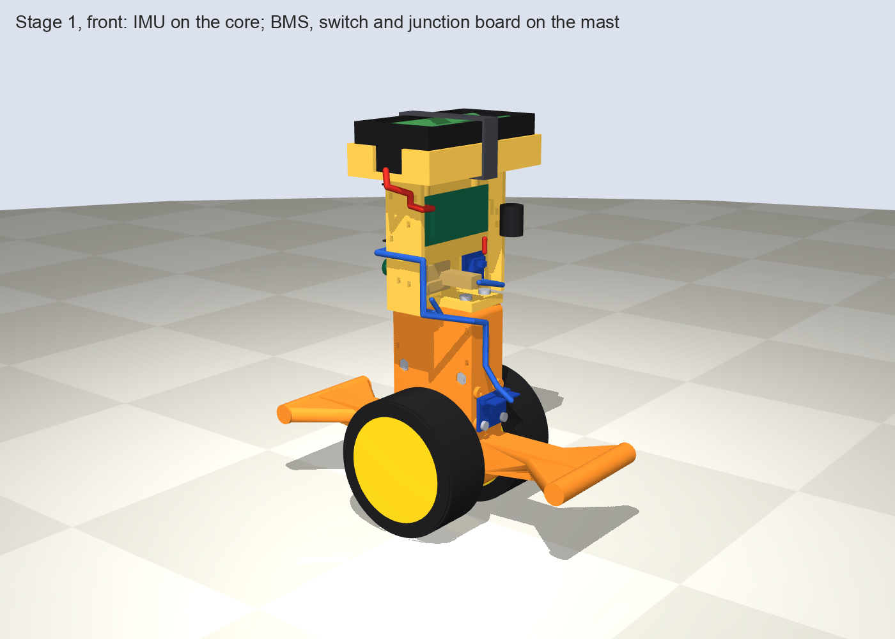
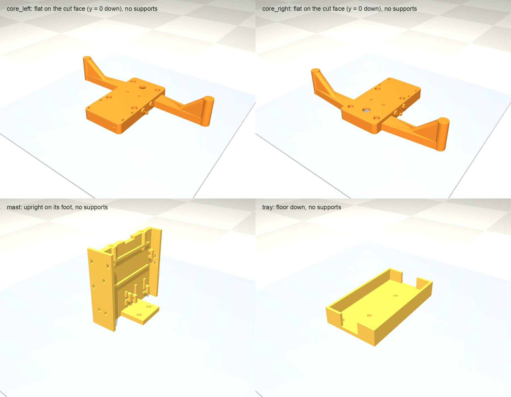
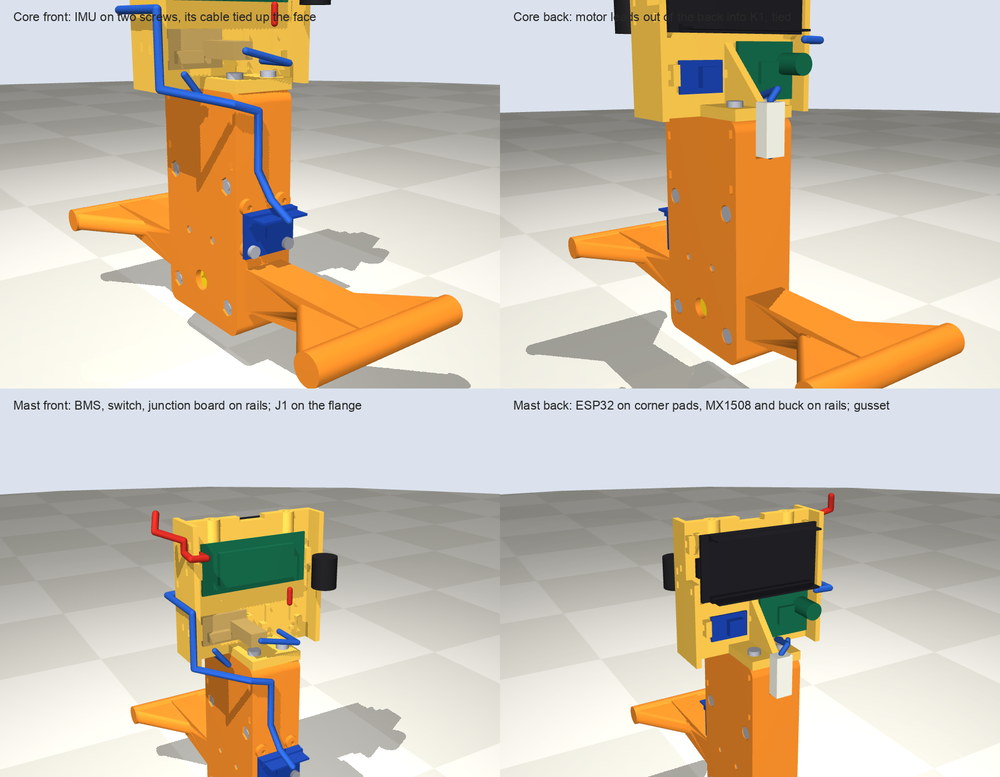

# Stage 1 mechanical design

> **Unbuilt.** Nothing here has been printed, assembled or measured. Every dimension in `stage1.py` is tagged
> [D] datasheet, [E] estimate (measure it) or [C] chosen by this design, and every result inherits those tags.
> Measure the parts listed under "Before you print" first; the TT motor and the boards are the biggest unknowns.

Wiring, pins and the power chain are in [`electronics.md`](electronics.md). The numbers below come from
`out/design.md`, which `stage1.py` writes; rerun it after changing any dimension.



## Files

| Path | What it is |
|---|---|
| `stage1.py` | Every dimension (tagged), the four printed parts, the bought parts, fasteners and main wire runs, the design check, the renders |
| `out/design.md` | Mass table, balance, falls, clash and access checks, bed fit, manifold check, wall thickness, overhangs, fastener walls, screw lengths, fall loads, PASS/FAIL summary |
| `out/print/*.stl` | The four printed parts, each in its print orientation, lying on the bed at z = 0 |
| `out/model.json`, `out/body.stl`, `out/wheels.stl` | What `sim.py` builds its model from |
| `out/render_*.png` | Front, back, orthographic views, exploded view, mounts close-up, each part on the bed |

```bash
cd stage1 && python stage1.py          # --no-render skips the pictures
```

## The layout in one paragraph

One dual-shaft TT gearmotor sits in a printed **core** with its shaft on the axle and the can pointing up; a 65 mm
wheel goes on each end of the shaft. The core is a clamshell split down the middle, so its two halves print flat.
Two 3 mm steel pins through the gearbox's own M3 holes locate it, and four M3 bolts with recessed heads and nuts
clamp the halves, so nothing sticks out into the 1.2 mm gap beside each wheel. Long crash bars front and back are
part of the core. A **mast** screws onto the top of the core: a 4 mm plate with edge flanges and a gusset, carrying
the BMS, switch and junction board on its front and the ESP32, motor driver and buck on its back. A separate
**tray** on top of the mast holds the battery holder, screwed through to the mast, with a strap over the cells. The
IMU is on the front of the core, 24 mm above the axle.

| | Value | Source |
|---|---|---|
| Mass | **347 g** (body 302 g, wheels and shaft 45 g) | [E], `out/design.md` section 1 |
| Centre of mass | 86.2 mm above the axle, +0.5 mm fore-aft | [E] |
| Size | 170 mm front to back, 86 mm wide, 189 mm tall | [C] |
| Track | 52.0 mm between wheel centres | [C] |
| Where a fall stops | 24.7 deg either way, on a crash bar | CAD (mesh check) |
| Printed | 98 g of PLA in four parts, no supports | [E] |

## What changed from the first pass, and why

| First pass | Now | Why |
|---|---|---|
| Printed pegs into the gearbox holes | Two 3 x 22 mm steel pins | The core halves print on their cut face; a peg would hang from the cheek with nothing under it. |
| 2.1 mm cheeks, 0.8 mm to the wheel | 2.3 mm cheeks, 1.2 mm to the wheel; wheel hub on 5.5 mm of the stub (was 5.9) | More cheek and more room for a wobbly wheel. 0.1 mm gearbox clearance along the shaft instead of 0.3 gives the extra cheek. |
| Five bolts, one near the top | Four bolts; the mast's four screws tie the top | The top bolt ran 0.8 mm from the can pocket. |
| Mast: 3 mm plate, 140 mm4 | 4 mm plate, two front and two back flanges, a 45 deg gusset behind the root: 3500 mm4 at its weakest, 13400 mm4 at the root | The battery on the old plate had a bending mode near 28 Hz and 5 mm of swing in a fall. Now about 280 Hz. |
| Battery tray printed with the mast | Separate tray, screwed through the holder to the mast | The tray floor would have been a 42 mm bridge or needed supports. Now both print with none. |
| Boards floating | Every board has a mount (below) | |
| No wires | Main runs modelled, tied at tunnels and anchors, clash-checked | |
| Core 42 mm long, top at 70 | 46 mm long, top at 72 | Room for bolt recesses with 2 mm walls and the motor tabs, leads and C3 above the can. |
| 302 g, centre of mass 89 mm up | 347 g, 86 mm up | Mostly a fuller accounting: fasteners 16 g (was 9), wiring 14 g, strap, ties, plugs, jack, fuse, C1 and the junction board are now counted; the core grew 15 g. |

## Printed parts

| Part | Size in print pose (mm) | Mass (g) | Orientation | Supports |
|---|---|---|---|---|
| `core_left` | 170 x 87 x 30 | 35 | Flat on the cut face (the y = 0 split), outer cheek up | None |
| `core_right` | 170 x 87 x 30 | 35 | Same, mirror | None |
| `mast` | 46 x 62 x 60 | 17 | Upright on its foot | None |
| `tray` | 46 x 82 x 14 | 11 | Floor down | None |

All four fit an Ender 3 bed (220 x 220); the core halves can go on one plate.



### Print settings

| | Core halves | Mast | Tray |
|---|---|---|---|
| Material | PLA | PLA | PLA |
| Layer height | 0.2 mm | 0.2 mm | 0.2 mm |
| Walls | 4 (1.6 mm) | 4 | 3 |
| Top / bottom layers | 7 / 5 | 5 / 5 | 5 / 5 |
| Infill | 30 % gyroid | 30 % gyroid | 20 % gyroid |
| Cooling | 100 % after layer 3; bridge settings on | 100 % | 100 % |

- **Bridges in the core.** The cheek over the gearbox pocket is the part's top: its first layer is a 23 mm bridge,
  then the rest of the 2.3 mm is solid top layers (7 top layers). The can pocket roof is a 13-15 mm bridge, the
  solder-tab and lead-slot roofs 4 mm. Let the slicer's bridge detection handle them; a slight sag only tightens
  the gearbox fit. Everything else that faces down is a hole roof or a ledge of 3.6 mm or less.
- **Elephant's foot.** The core prints on its split face, which is also the mouth of the gearbox pocket. The
  pocket has a 0.4 mm chamfer at that face so a squashed first layer does not pinch the gearbox; also turn on
  elephant's-foot compensation (0.2 mm) if your slicer has it.
- **Holes.** Holes are drawn at nominal size: 3.4 mm for M3 clearance, 2.5 mm pilots for M3 self-tappers, 2.1 mm
  for M2.5, 3.0 mm for the steel pins, 8 mm for the shaft. The pin holes and bolt holes print vertically (round).
  Run a 3.0 mm drill through the pin holes so the pins press in snugly, and a 3.4 mm drill through anything an M3
  must pass freely.
- **Walls.** The thinnest real walls are 1.9 mm (IMU pilots), 2.1 mm (nut recesses, mast-screw pilots) and 2.3 mm
  (the cheeks). The ray-cast check finds nothing under 1.6 mm except the 1.5 mm edges of rails and tie anchors.
- **Strength direction.** The core's crash arms are loaded along the layers (strong). The mast and the ends of the
  crash bars are loaded across the layers (weaker); section 6 of `out/design.md` checks them with that in mind.

## Board mounts

All board sizes are [E], from typical listings. **Measure yours** before printing; every position is a named
parameter at the top of `stage1.py`. Boards without holes sit on 1.6 mm printed rails (so their solder joints clear
the plastic) and are held by one 2.5 mm zip tie through printed tie anchors.



| Board | Where (body frame, mm) | Assumed size | How it is held | Check on yours |
|---|---|---|---|---|
| **GY-521 IMU** | Front of the core, y -10.5..10.5, z 16..32, chip forward, 2 mm off the core | 21 x 16 x 1.6 [E], two ~3 mm holes 15 mm apart, 2.5 mm in from the edge opposite the header | Two M2.5 x 8 self-tappers into printed posts. Four pilots: the lower pair (z 18.5) for a board mounted 21 wide x 16 tall, or one side pair (y -7.5 or +7.5, z 18.5 and 33.5) for 16 wide x 21 tall. A small rest pad at the centre clears the header joints either way. | Hole spacing; where the silkscreen X arrow points (below) |
| **ESP32 DevKit** | Back of the mast, across, y -27.5..27.5, z 100..128, module towards the plate, pins pointing back, USB to the robot's left | 55 x 28 [E] (38-pin, WROOM-32); first header pin 3.35 mm from each end | Four corner pads 6 mm tall under the PCB corners (clear of the module and the pin tails) and two zip ties along the board between the header rows, through holes in the two back flanges and one anchor. No screws: hole patterns vary between clones and most 38-pin boards have none. A 30-pin board (about 51 x 28) also fits; move the pads. | Length, width, where the first and last header pins are, module width (18), the USB end |
| **MX1508** | Back of the mast, robot right, y -27..-2.3, z 76.5..97.5 | 24.7 x 21 [E], no holes; C1 470 uF on its + / - pads | Two rails, one tie through the flange root and the gusset root | Size, which edge has the motor pads |
| **Mini360** | Back of the mast, robot left, y 4..21.2, z 80..91.2 | 17.2 x 11.2 [E] | Two rails, one tie through the gusset root and an anchor | Size |
| **2S BMS** | Front of the mast, top, y -25..25, z 101..123 | 50 x 22 x 3.5 [E] | Two rails, one tie through two anchors | Size |
| **SW1 switch** | Front of the mast, robot left, y 6..21.2, z 77..92.2, slider forward | 15.2 x 15.2 [E] (Pololu 2810 size) | Two rails, one tie low on the board, clear of the slider. 1.5 mm free round a fingertip on the slider. A KCD11 rocker would need its own panel hole. | Size, slider position |
| **JB junction board** | Front of the mast, robot right, y -25.5..-4.5, z 79..92 | Perfboard cut to 8 x 5 holes, about 21 x 13 [E] | Two rails, one tie through two anchors. The K2 header stands on it; the mated K2 plug points forward with 2 mm of finger room round it. | Cut size |
| **K1 motor plug** | Back face of the core, y -3.8..3.8, z 60..78 | JST-XH 2-pin, mated, ~7.5 x 5.8 x 18 [E] | Tied flat to the back of the core through the core's upper back tunnel (z 67.5). The core comes off the mast by unplugging it. | |
| **J1 charge jack** | Hangs vertically in front of the robot-left front flange, centre (15.8, 28), z 100..114, socket pointing down | 11 mm diameter, 14 mm long [E] | Two ties round the jack and the flange's front edge, through the flange's two tie holes. A 10 mm charger plug comes in from below with 0.8 mm to spare. | Body diameter |
| **C3, 100 nF** | Across the motor tabs, in the 5 mm pocket above the can | ~7 x 2.6 x 4 [E] | Soldered to the tabs | |
| **Battery holder** | Tray, z 135..155.5 | 41 x 77.5 x 20.5 [E], two floor holes assumed on its centre line at y +-18 | Two M3 x 16 self-tappers down through the holder floor and the tray into bosses in the mast top (cells out to fit them). If your holder's holes are elsewhere, drill 3.2 mm holes at those two places. A 10 mm hook-and-loop strap round holder and tray holds the cells; it passes under the tray through a groove in the mast top. | Outer size, floor holes, floor thickness |

**GY-521 orientation.** The firmware wants the chip facing forward and the silkscreen X arrow pointing **up**.
The model draws the board 21 mm wide and 16 mm tall with its header along the top edge; that is right only if your
board's X arrow runs across the header. If it runs along the header, X-up turns the board 16 wide by 21 tall with
the header on one side: use the two pilots on the side away from the header (y +7.5 or -7.5, z 18.5 and 33.5). The
IMU then sits about 7 mm higher and up to 2.5 mm sideways; nothing else changes. Solder the header with its pins on
the chip side (pointing forward) so the board lies flat on the posts.

**Other changes to the board layout.** These follow `electronics.md`'s positions, with these differences:
the ESP32 moved up 1 mm (z 100..128), the MX1508 is on the robot-right back at y -27..-2.3 (it must clear the 3 mm
gusset at y = 0), the Mini360 is at z 80..91.2, the BMS top at z 101..123, the switch at z 77..92.2, JB at
y -25.5..-4.5, z 79..92, K1 is on the back of the core rather than above the mast foot, and J1 is tied in front of
the robot-left flange.

## Wire routes

Every run is drawn in the model and checked against every part and the wheels; nothing passes within the wheels'
swept volume. Tie each run where listed.

| Run | Route | Tie points |
|---|---|---|
| Motor leads (and C3) | Soldered to the tabs above the can, out of the slot in the back of the core at z 59..64, into K1, then up to the MX1508's motor pads beside the gusset | K1 through the core's upper back tunnel |
| IMU cable (four 20 cm jumpers) | Up the front of the core, out to the robot-right side under the mast plate (z 69, clear of the wheels: they reach z 32.5), up outside the robot-right flanges, round the flange's free edge at z 98 to the ESP32: 3V3 on its lower header row; GND, IO22 and IO21 on its upper row (z about 126), about 30 mm further up beside the antenna end | Core front tunnels at z 48 and 63; the front-right flange tie hole |
| Battery leads | Out of the tray's robot-right end notch, down the outside of the robot-right front flange, round its front edge into the BMS at z 119 | Front-right flange tie hole at z 124 |
| Switch and K2 | BMS output down to the switch beside it; switch to the K2 plug on JB | The switch and JB ties |
| Rail to the MX1508 | From JB under the plate's bottom edge at y -15 (outside the core, above the wheels) to the MX1508's + / - pads on the back | JB tie |

The mast's two faces connect either under the plate's bottom edge where it overhangs the core (|y| over 12) or round
its robot-right edge; `electronics.md` takes the battery-sense wire and the IMU jumpers round the edge and the rest under the plate.

## Fasteners

| Qty | Part | Where | Length check |
|---|---|---|---|
| 4 | M3 x 20 socket head cap screw (ISO 4762) | Core clamp, heads in the left half | Head top 0.2 mm below the cheek face |
| 4 | M3 hex nut (ISO 4032) | Hex recesses in the right half | Bolt passes the whole nut, tip 0.4 mm below the cheek face |
| 2 | 3 mm steel pin, 22 mm (a 3 x 22 dowel, or 3 mm rod cut and filed) | Through the gearbox's two holes into both cheeks | Ends 0.8 mm below the cheek faces, 1.5 mm in each cheek |
| 4 | M3 x 12 pan-head self-tapping (thread-forming for plastic) | Mast foot to core top | 8 mm into a 10 mm pilot |
| 2 | M3 x 16 pan-head self-tapping | Holder floor, tray floor, into the mast bosses | 11.8 mm into a 12 mm pilot |
| 2 | M2.5 x 8 pan-head self-tapping | GY-521 to the core | 6.4 mm into an 8 mm pilot |
| 2 | Wheel screws (supplied with the wheels) | Wheel hub into the end of each shaft stub | |
| about 12 | 2.5 mm zip ties, 100 mm | Boards, K1, J1, wire runs | |
| 1 | Hook-and-loop strap, 10 mm wide, about 200 mm | Over the cells | |

Each fastener hole has at least 1.9 mm of plastic round it (`out/design.md` section 5).

## Before you print: measure these

1. **TT gearmotor.** Gearbox thickness along the shaft (18.8 assumed), width (22.5), length (37), shaft to the near
   end (11), stub length beyond each face (9.1), shaft boss diameter (under 7.4), **the two through-holes** (assumed
   at x +-8, z 18 from the shaft), can diameter and across-flats (20 and 15), and how far the solder tabs stand above
   the can (5 mm allowed, C3 included). These live in `cad/tailwhip.py` (`TT_*`) and `stage1.py`.
2. **Wheels.** Outer diameter, width, and how deep the hub goes on the shaft (5.5 mm used); spin one on a stub and
   check the inner face wobbles less than 1 mm (the gap to the cheek is 1.2 mm).
3. **Boards** in the table above, and the **battery holder**.

Then print `core_left` first and check the gearbox fit, the pin holes and the wheel gap before printing the rest.

## Assembly

1. **Clean up the prints.** Drill the pin holes 3.0 mm and the clamp-bolt holes 3.4 mm. Run each self-tapper into
   its pilot once and back it out, so the final assembly does not strip.
2. **Motor.** Solder about 60 mm of lead and C3 across the two tabs, and crimp or solder the K1 socket on the leads.
3. **Core.** Lay `core_right` on the bench, cut face up. Press the four nuts into their hex recesses from the outside.
   Push the pins through the gearbox holes, drop the motor in (shaft in the half-hole, can up, leads out of the
   back slot), add `core_left`, and fit the four M3 x 20 bolts from the left. Tighten evenly until the halves meet;
   do not crush the gearbox.
4. **IMU.** Check the X arrow (above), then fix the GY-521 with two M2.5 x 8 self-tappers on the matching pilots.
5. **Wheels.** Push a wheel onto each stub until the hub sits 5.5 mm on (1.2 mm from the cheek), then fit the
   wheel screws. Spin each by hand: nothing may touch.
6. **Mast boards.** Before the mast goes on: ESP32 on its four pads, two ties through the back flange holes and the
   anchor; MX1508 and Mini360 on their rails, one tie through the flange root and gusset root; BMS, switch and JB on
   the front rails, one tie each through their anchors. Wire everything that stays on the mast (see `electronics.md`).
7. **Mast to core.** Set the mast on the core top and fit four M3 x 12 self-tappers. Plug K1 and tie it through the
   core's upper back tunnel. Tie the IMU cable through the two front tunnels and route it as above.
8. **Tray and battery.** Holder in the tray, cells out. Two M3 x 16 self-tappers through the holder and tray into the
   mast bosses. Battery leads out of the robot-right notch, down and tied, to the BMS. Tie J1 in place.
9. **Cells and strap.** Thread the strap under the tray through the groove, cells in, strap over. Switch on only
   after the checks in `electronics.md`.

## Checks (`out/design.md`)

22 PASS, 0 FAIL. Among them:

- **Clashes:** no overlap between any two solids (printed parts, motor, wheels, boards, plugs, fasteners, wires, strap).
- **Wheels through a full turn:** 1.2 mm from the cheeks, 1.4 mm from the bolt heads.
- **Access:** USB plug 0.3 mm from the nearest part (the back-left flange stops just below it; a bulky plug may need
  that corner trimmed), finger on the switch 1.5 mm, charger plug 0.8 mm, K2 grip 2.0 mm, cells lift out with the
  strap off.
- **Bed:** each STL is one valid manifold lying at z = 0 and fits the bed.
- **Falls:** first touch 24.7 deg forward and back, on the crash bars (as before). Fall loads, from a two-mass
  impact model with a fixed axle and a rigid floor (worse than real): crash-arm root 10 MPa (safety factor 3.9),
  crash-bar end when one end lands first 9 MPa across the layers (2.1), mast 7 MPa across the layers (2.7), in a
  hard fall (3 rad/s shove on top of a topple).
- **Cheeks:** a 100 N sideways landing on a wheel is under 0.4 MPa in the cheek; the cheek's risk is how well its
  bridge prints, not strength.

## Limits

- **Every bought-part number is an estimate.** The gearbox and its two holes matter most: if the holes are not at
  x +-8, z 18, the pins will not go in. Measure first, print `core_left` first.
- **Mass went up.** 347 g against the first pass's 302 g, mostly because more is now counted. `out/sim.md` is rerun
  with the new mass and centre of mass.
- **The fall check is a model, not a test.** It assumes PLA strengths [E] and ignores layer adhesion that varies
  with the printer. Side falls onto the tray and onto a wheel are only estimated. Drop-test on carpet first.
- **The crash-bar ends are the weakest printed feature** (loaded across the layers). If one cracks, reprint the core
  half; a future revision could run an M3 rod through each bar.
- **Board mounts assume typical sizes.** A bigger BMS or a different switch needs the rails moved in `stage1.py`.
- **Zip ties** hold most boards. They are fine for vibration; the IMU, which must not move, has screws.
- **Wheel fit.** Each wheel sits on 5.5 mm of a 9.1 mm stub with 1.2 mm to the cheek. A loose hub will wobble into
  the cheek; a drop of glue or a printed spacer fixes that.
- **Narrow track** (52 mm): it tips sideways past about 20 deg of roll. Flat floors only.
