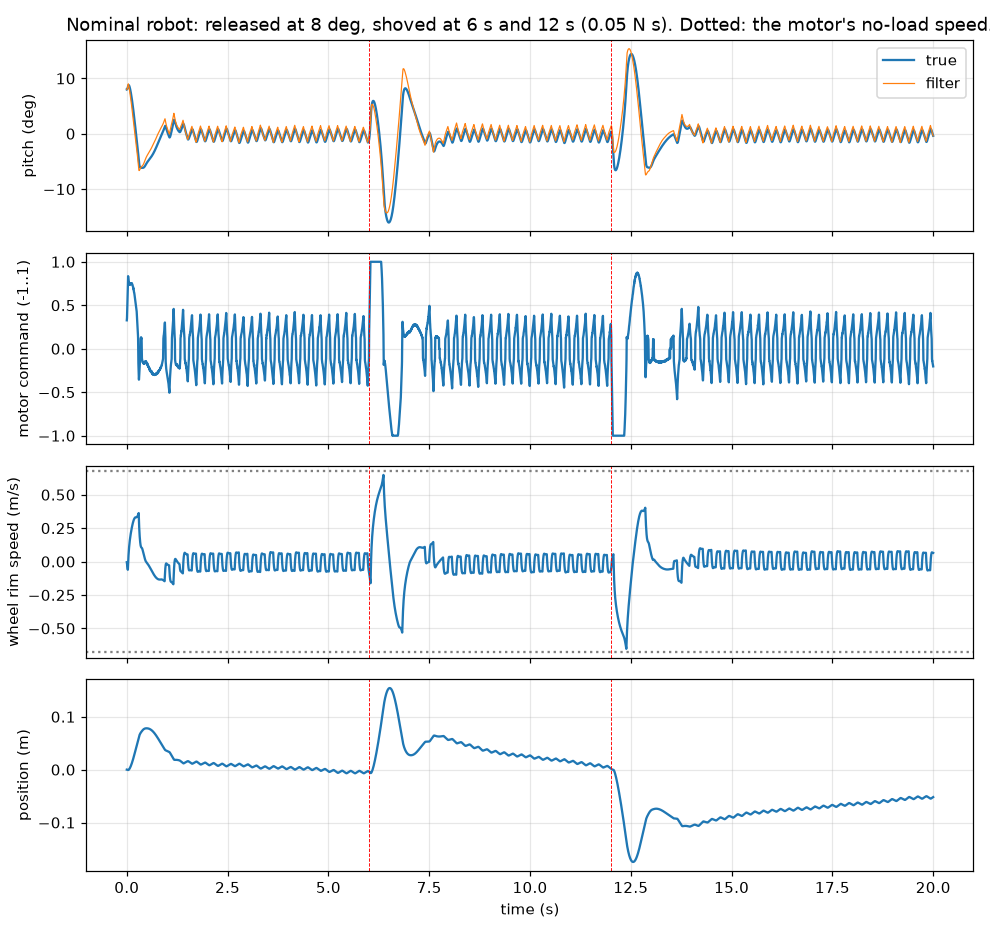
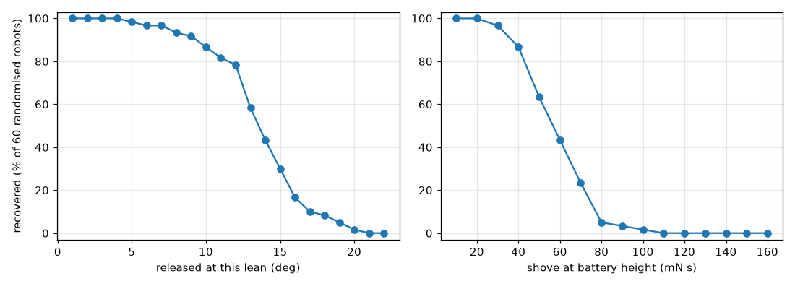
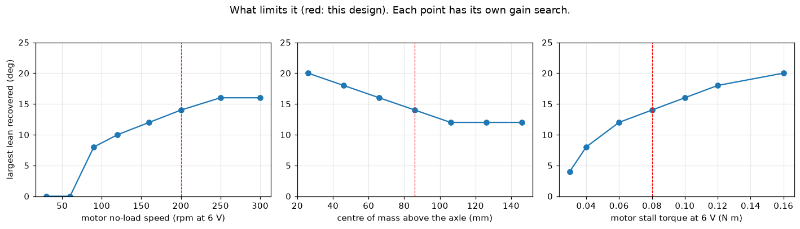

# Stage 1 balancer: simulation results

Generated by `sim.py test`. MuJoCo, 800 Hz physics, the firmware's filter and PID at 400 Hz, IMU only. Motor and gearbox figures are estimates until the bench measurements exist.

Gains (u per rad, per rad/s, per m/s, per m): kp 1.62, kd 0.37, kv 1.94, kx 0.11, ki 0, dead-zone compensation 0.1.

## Does it stay up

- **Nominal robot, 20 s, released at 8 deg and shoved twice (0.05 N s):** stays up. Pitch rms 3.1 deg, ends 5 cm from where it started, motor saturated 3 % of the time, peak wheel speed 0.65 m/s of 0.68 available.
- **300 randomised robots, 20 s, random start lean up to 5 deg, two shoves of 0.02-0.05 N s:** **257 stay up (86 %)**. Median pitch rms 2.3 deg, median drift 41 cm (90th percentile 134 cm), 90th-percentile peak wheel speed 0.64 m/s.
  - The ones that fell, on average: mu 0.694, stall 0.0686, w0 20.1, backlash_deg 5.51, motor_tau 0.0178, deadzone 0.0975, vbat 7.61, mass 0.987, com_dz -0.000755.
- **Left alone (no shoves), 60 randomised robots, 20 s:** 60 stay up; median wobble about its own balance point 0.77 deg rms, median drift 47 cm.

## How much it can take

- **Release angle:** the nominal robot recovers from **13 deg** either way; 90 % of randomised robots recover from 9 deg.
- **Shove at battery height:** nominal **50 mN s**; 90 % of randomised robots take 30 mN s. For scale, 50 mN s is a 50 g ball arriving at 1 m/s.

## What limits it

| Motor no-load speed (rpm) | 30 | 60 | 90 | 120 | 160 | 200 | 250 | 300 |
|---|---|---|---|---|---|---|---|---|
| Largest lean recovered (deg) | 0 | 0 | 8 | 10 | 12 | 14 | 16 | 16 |

| Centre of mass above axle (mm) | 26 | 46 | 66 | 86 | 106 | 126 | 146 |
|---|---|---|---|---|---|---|---|
| Largest lean recovered (deg) | 20 | 18 | 16 | 14 | 12 | 12 | 12 |

| Stall torque at 6 V (N m) | 0.03 | 0.04 | 0.06 | 0.08 | 0.1 | 0.12 | 0.16 |
|---|---|---|---|---|---|---|---|
| Largest lean recovered (deg) | 4 | 8 | 12 | 14 | 16 | 18 | 20 |

## Getting up by itself

Lying on a crash bar at 25 deg, a fixed kick (roll away for 0 ms, then full power under the body, hand over to the PID inside 15 deg) gets **57 %** of 40 randomised robots back up; nominal robot: yes.

